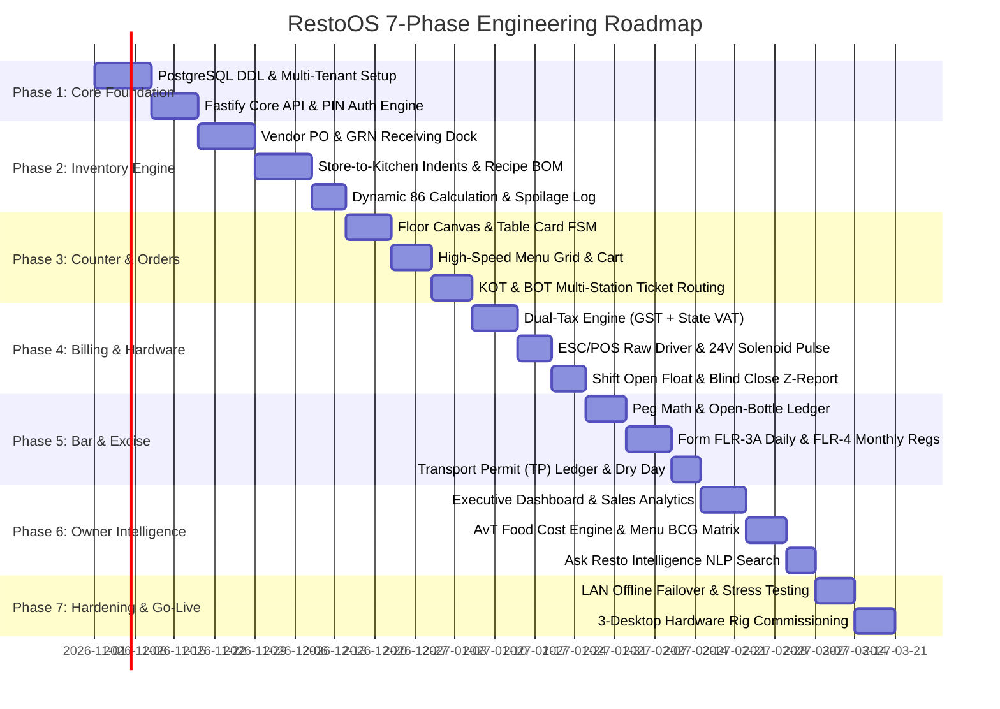

# RestoOS — Full System Blueprint & Master Implementation Plan
## High-Throughput Restaurant, Bar & Two-Tier Inventory Operating System (Indian Standard)

**Document Version:** 1.0.0-FINAL  
**System Designation:** RestoOS  
**Deployment Profile:** 3-Desktop Local LAN Mesh (Zero Internet Dependency during Service)  
**Regulatory Baseline:** Indian Tax Laws (GST @ 5% vs. State VAT on Liquor), State Excise FL-3 / FLR-3A / FLR-4 Compliance, FSSAI Standards  
**Design Reference:** Minimalist, High-Speed Ergonomics (Inspired by Covers / Rasa Sahyadri)  

---

## 1. High-Level Architecture & Hardware Topology

The V1 deployment is engineered as a **3-Desktop Local Area Network (LAN)** with zero reliance on cloud uptime for live floor orders, billing, and kitchen ticket dispatch.

```
+-----------------------------------------------------------------------------------------------------------------------+
|                                              RESTAURANT IN-HOUSE LOCAL LAN (Ethernet / 5GHz Wi-Fi)                    |
|                                                                                                                       |
|   [ DESKTOP 1: CASH COUNTER 1 (MAIN) ]          [ DESKTOP 2: CASH COUNTER 2 (FAST-LANE) ]    [ DESKTOP 3: STORE & OWNER ADMIN ] 
|   - Cashier & Table Order Taking                - Secondary Cashier / Takeaway Billing       - Storekeeper / General Manager / Owner
|   - Live Table Floor Map (Ground/Terrace)       - Live Table Floor Map                       - Central Store Grocery Purchasing (PO/GRN)
|   - Menu Search with "Veg Only" Toggle          - Fast-Lane Takeaway (`+ Takeaway`)          - Store-to-Kitchen Indents / Requisitions
|   - KOT & BOT Multi-Station Ticket Firing       - KOT & BOT Multi-Station Ticket Firing      - Recipe Bill of Materials (BOM) Setup
|   - Dual-Tax Billing (GST @ 5% + State VAT)     - Dual-Tax Bill Settlement                   - State Excise FLR-3A & FLR-4 Registers
|   - Multi-Tender: Cash, Dynamic UPI QR, Card    - Multi-Tender Settlement                    - Kitchen Wastage & Spoilage Logs
|   - 24V Solenoid Cash Drawer Kick Pulse         - Attached 80mm Thermal Receipt Printer      - Full Menu, Pricing, Staff PINs, & Audits
|   - Shift Open Float & Blind Close (Z-Report)                                                - **OWNER EXECUTIVE DASHBOARD**
|   - Attached 80mm Thermal Receipt Printer                                                      (Full system access & live analytics)
|   * [HOSTS LOCAL FASTIFY SERVER + POSTGRESQL]                                                                         |
+-------------------------------------------------------+---------------------------------------------------------------+
                                                        |
                            +---------------------------+---------------------------+
                            | LAN Raw TCP (Port 9100)                               | LAN Raw TCP (Port 9100)
                            v                                                       v
         +-------------------------------------+                 +-------------------------------------+
         |       KITCHEN THERMAL PRINTER       |                 |         BAR THERMAL PRINTER         |
         |    Physical 80mm Paper KOT Output   |                 |    Physical 80mm Paper BOT Output   |
         |    (Station: Hot Line / Curry / Fry)|                 |    (Station: Dispense Bar / Cocktails)
         +-------------------------------------+                 +-------------------------------------+
```

---

## 2. Desktop Responsibilities & Hardware Interfacing

| Station | Host Hardware | Peripherals Attached | Core Operational Workflows |
| :--- | :--- | :--- | :--- |
| **Desktop 1: Main Cash Counter** | Windows/Linux PC (Intel i5, 16GB RAM) | • 80mm Thermal Receipt Printer (USB)<br>• 24V Solenoid RJ12 Cash Drawer<br>• 2D Barcode / QR Scanner (USB) | • **Local Server Core:** Runs PostgreSQL 16 & Fastify API.<br>• **Unified Workspace:** Table floor map, order punching, KOT/BOT dispatch.<br>• **Dual-Tax Billing:** Food GST + Liquor VAT calculation.<br>• **Register Security:** Shift open float, safe drops, blind close Z-Report. |
| **Desktop 2: Secondary / Takeaway Counter** | Windows/Linux PC (Intel i3, 8GB RAM) | • 80mm Thermal Receipt Printer (USB/LAN) | • **Peak-Hour Concurrency:** Parallel table checkout during rush hours.<br>• **Takeaway Fast-Lane:** Instant OTC takeaway orders without table binding.<br>• **Independent Cashier Session:** Separate cash drawer/shift balancing. |
| **Desktop 3: Store & Owner Command PC** | Windows/Linux PC or Laptop | • Standard Office Laser/Inkjet Printer (A4) | • **Central Store Inward:** Vendor POs, GRN with batch/expiry tracking.<br>• **Kitchen Indents:** Requisition approval and stock issue notes.<br>• **State Excise Office:** Form FLR-3A daily brand register & Form FLR-4.<br>• **Owner Executive Dashboard:** Universal access, AvT food cost variance, P&L. |
| **Kitchen Station** | Network Appliance | • 80mm Network Thermal Printer (Static IP: `192.168.1.200`, Port 9100) | • Prints physical paper KOT tickets immediately when fired from Desk 1 or 2.<br>• Auto-cutter enabled; buzzer audio chime for rush alerts. |
| **Bar Dispense** | Network Appliance | • 80mm Network Thermal Printer (Static IP: `192.168.1.201`, Port 9100) | • Prints physical paper BOT tickets for liquor pegs, beers, and cocktails.<br>• Automatically filters out food items. |

---

## 3. Detailed Functional Module Blueprints

### Module 1: Unified Cash Counter & Table Operations
* **Floor Plan Engine:** Multi-zone layout (`Ground floor`, `Terrace`, `AC Hall`, `Garden`).
* **Table Card Component:** Displays table identifier (`T1` to `T20`), capacity (`4 seats`), and live occupancy timers:
  * `● Open` (Soft green dot): Vacant table ready for seating.
  * `● now` (Amber dot): Table seated within the last 5 minutes.
  * `● 20 m` / `● 45 m` (Orange timer): Seated duration tracking to identify service delays.
* **High-Speed Menu Selection:**
  * Categorized tabs across top: `Breakfast & Snacks`, `Veg Starters`, `Non-Veg Starters`, `Mains`, `Breads`, `Bar & Spirits`, `Beers`.
  * Instant search bar with keyboard auto-focus (`Ctrl+F` or `/`).
  * Dedicated `Veg only` toggle switch with green badge.
* **Order Cart & Kitchen Routing:**
  * Incremental quantity steppers (`[-] 1 [+]`) and unit pricing.
  * Prep notes ("Less spicy", "No garlic", "Extra ice").
  * **Smart Ticket Splitter:** Hitting `Send to Kitchen (F2)` evaluates item categories:
    * Food items $\rightarrow$ dispatched to **Kitchen Thermal Printer (KOT)**.
    * Alcohol items $\rightarrow$ dispatched to **Bar Thermal Printer (BOT)**.
  * Running orders: Adding extra rotis or drinks later only prints the newly added items on subsequent tickets.

---

### Module 2: Dual-Tax Billing & Cash Counter Register
* **Constitutional Dual Taxation:**
  * Food & Non-Alcoholic Beverages: **GST @ 5%** (2.5% CGST + 2.5% SGST) with FSSAI & GSTIN numbers.
  * Alcoholic Beverages: **State VAT (MVAT @ 5% or 10%)** with State Excise License No. (FL-3) and VAT TIN.
  * Consolidated bill layout with clear Part A (Food) and Part B (Bar) sub-totals, statutory health warning, and grand total in numbers and words.
* **Payment Multi-Tender:** Cash, Dynamic UPI QR code (generated on receipt screen), Credit/Debit Card, and Khata (Customer Credit).
* **Hardware Cash Drawer Kick:** Generates standard ESC/POS 24V pulse (`\x1b\x70\x00\x19\xfa`) over receipt printer RJ12 port upon cash settlement.
* **Shift Management & Cash Security:**
  * Shift Open: Input opening cash float.
  * Paid-In & Paid-Out vouchers for petty cash expenses (e.g. ice, dairy).
  * Safe Drops: Prompts cashier to deposit excess currency into safe when drawer exceeds ₹15,000.
  * **Blind Cash Close (Z-Report):** Cashier counts physical cash without seeing system figures. System computes Over / Short variance, prints Z-Report slip, and seals the shift.

---

### Module 3: Central Store Grocery Procurement (Tier 1 Inventory)
* **Vendor Catalog & Rate Contracts:** Master list of suppliers with agreed prices per unit (kg, L, bags, cases).
* **Purchase Order (PO) Workflow:** `Draft` $\rightarrow$ `Approved` $\rightarrow$ `Sent` $\rightarrow$ `Partially Received` $\rightarrow$ `Completed`.
* **Goods Received Note (GRN):**
  * Inward dock inspection: Captures PO number, invoice number, supplier batch number, expiry date, received quantity vs. PO quantity.
  * Weighted Average Costing (WAC) recalculated on every GRN commit:
    $$\text{WAC}_{\text{new}} = \frac{(\text{Current Qty} \times \text{Current WAC}) + (\text{Received Qty} \times \text{Invoice Unit Cost})}{\text{Current Qty} + \text{Received Qty}}$$
  * Unit of Measure (UOM) conversions: Auto-converts bulk units (e.g. 50 kg flour bag) into stocking units (kg/grams).

---

### Module 4: Kitchen Line Inventory & Recipe Bill of Materials (BOM) (Tier 2 Inventory)
* **Store-to-Kitchen Indents / Requisitions:**
  * Kitchen Chef punches daily ingredient request (e.g., 10 kg Chicken, 5 kg Paneer, 15 L Cooking Oil).
  * Storekeeper verifies and issues goods $\rightarrow$ Deducts Central Store balance and credits Kitchen Line Stock balance.
* **Recipe Bill of Materials (BOM) & Yield Shrinkage:**
  * Defines raw material consumption per menu item down to grams/milliliters.
  * Yield shrinkage percentage factors: Raw potato peeling loss (15%), chicken butchery deboning loss (20%), evaporation loss on prep gravies.
* **Real-Time Dynamic 86ing:**
  * Software tracks remaining portions of each dish based on active kitchen line stock.
  * When key ingredients hit zero, floor ordering displays instant sub-50ms lockout (`ITEM_86_AUTO`).
* **Kitchen Wastage & Spoilage Register:**
  * Food waste logged with mandatory reason codes (`BURNT_BY_COOK`, `DROPPED_BY_STAFF`, `EXPIRED_PREP`, `TRIM_WASTE`) and supervisor PIN sign-off.

---

### Module 5: Bar Dispense & State Excise Compliance Engine (FL-3)
* **Statutory Compliance Guardrails:**
  * Automated Dry Day Lockout: Calendar locks bar billing on national holidays, election days, and religious dry days.
  * Minimum Legal Drinking Age (MLDA) verification prompt (21 / 25 years).
  * Bar counter operating hours closing timer (e.g. cut-off at 11:30 PM).
* **Peg Measurement & Open-Bottle Tracking:**
  * Standard conversion: 750 ml bottle = $25 \times 30\text{ ml}$ Small Pegs, or $12.5 \times 60\text{ ml}$ Large/Patiala Pegs.
  * Draught Beer Kegs (30L/50L): Depleted by 330ml mugs, 500ml glasses, 1500ml pitchers.
  * Open Bottle Ledger: When the first peg of a bottle is sold, 1 sealed bottle is decremented from stock, and milliliters are depleted from the active open bottle until empty.
* **Mandatory State Excise Registers (Maharashtra / Pan-India Standard):**
  * **Form FLR-3 & FLR-3A:** Daily brand-wise and size-wise stock & sales ledger ($\text{Opening} + \text{Inward TP} - \text{Sales} - \text{Breakage} = \text{Closing}$) generated and sealed daily before closing.
  * **Transport Permit (TP) Inward Ledger:** Inward entry of wholesale liquor consignments linked to excise TP numbers, batch codes, vehicle numbers, and holograms.
  * **Form FLR-4 Monthly Return:** Consolidated monthly return filed with the District State Excise Office by the 7th of every month.
  * **Breakage & Spoilage Register:** Logged with reason codes and manager PIN verification.

---

### Module 6: Owner Executive Dashboard & Data-Driven Intelligence
* **Universal Super-Admin Authority:** Complete administrative override power across all 3 desktops, menu rates, inventory reconciliations, staff PINs, and audit logs.
* **Live Financial KPIs:** Gross Sales, Net Sales (excl. GST/VAT), Statutory Tax Collections, Tender Distribution (Cash vs. Dynamic UPI vs. Card vs. Khata), and pending UPI payment verifications.
* **Operational Velocity:** Total covers served today, Average Revenue Per Table (ARPT), Average Spend Per Cover (ASPC), and hourly revenue pacing heatmaps (lunch vs. dinner).
* **Actual vs. Theoretical (AvT) Food Cost Engine:**
  $$\text{Food Cost Variance} = \text{Actual Consumption} - \text{Theoretical BOM Consumption}$$
  * Pinpoints ingredient theft, over-portioning, and kitchen prep trimming losses.
* **Menu Engineering Matrix (BCG Quadrant):**
  * **Stars:** High Margin, High Popularity (promote heavily).
  * **Plowhorses:** Low Margin, High Popularity (re-engineer cost or modest price bump).
  * **Puzzles:** High Margin, Low Popularity (reposition or bundle).
  * **Dogs:** Low Margin, Low Popularity (retire or 86).
* **Audit-at-a-Glance (Fraud Radar):**
  * Automatically flags suspicious activity: Manager-only voids, excessive manual discounts, and manual cash drawer kicks without a sale.
* **Conversational "Ask Resto Intelligence":**
  * Natural language search bar for instant business queries (*"What sold best today?"*, *"Show chicken consumption vs sales"*, *"What did we spend from the drawer?"*).

---

## 4. Master Relational Database Schema (PostgreSQL 16)

```
                                  [ tenants ]
                                       │
        ┌──────────────────────────────┼──────────────────────────────┐
        ▼                              ▼                              ▼
  [ users & PINs ]             [ dining_tables ]               [ raw_materials ]
        │                              │                              │
        │                              ▼                              ▼
        │                      [ table_sessions ]            [ store_stock_ledger ]
        │                              │                              │
        ▼                              ▼                              ▼
  [ cash_shifts ]              [ orders & bills ]            [ store_indents ]
        │                              │                              │
        ▼                              ▼                              ▼
[ shift_reconcile ]            [ order_items ]               [ kitchen_stock_ledger ]
                                       │                              │
                                       ▼                              ▼
                               [ kot_bot_tickets ]           [ recipe_bom_items ]
                                       │                              │
                                       ▼                              ▼
                               [ settlements ]               [ wastage_logs ]
                                                                      │
                                                                      ▼
                                                            [ excise_flr3a_reg ]
```

---

## 5. Thermal Printing Protocols & Ticket Formats

### 5.1 Kitchen Order Ticket (KOT) — 80mm
```text
========================================
             KITCHEN TICKET
Table: T7 (Ground Floor)      KOT #: 104
Date: 27-Oct-2026 13:15       Server: Rahul
========================================
QTY  ITEM                             
----------------------------------------
 1   Chicken Sukka                    
     >> Note: Extra spicy             
 1   Mutton Rassa (Full)              
 2   Jowar Bhakri                     
========================================
```

### 5.2 Bar Order Ticket (BOT) — 80mm
```text
========================================
            BAR ORDER TICKET (BOT)
Table: T7 (Ground Floor)      BOT #: 058
Date: 27-Oct-2026 13:15       Server: Rahul
========================================
QTY  ITEM                      POUR     
----------------------------------------
 2   Blenders Pride Whisky     60 ml (Large)
     >> Mixer: Soda & Ice               
 1   Kingfisher Premium Beer   650 ml   
 1   Sula Shiraz Red Wine      Glass (150ml)
========================================
```

### 5.3 Consolidated Dual-Tax Customer Invoice — 80mm
```text
================================================
                 RASA SAHYADRI
      RESTAURANT & PERMIT ROOM (BAR)
       Lane 6, North Main Road, Pune
       GSTIN: 27AAKFR4621M1Z5
       FSSAI: 11523034000412
    EXCISE LIC (FL-3): FL3-PUN-KP-0412
       MVAT TIN: 27912345678V
================================================
TAX INVOICE: KPB3/2026/009008
Date: 27-Oct-2026 13:45       Table: T7
Cashier: Counter 1            Guests: 2
------------------------------------------------
PART A: FOOD & BEVERAGES (GST)
ITEM                       QTY    RATE    AMOUNT
Chicken Sukka                1  340.00    340.00
Jowar Bhakri                 2   35.00     70.00
------------------------------------------------
Food Sub-total:                           410.00
CGST @2.5%:                                10.25
SGST @2.5%:                                10.25
Food Total (Incl. GST):                   430.50
------------------------------------------------
PART B: LIQUOR & BAR (STATE VAT)
ITEM                       QTY    RATE    AMOUNT
Blenders Pride (60ml)        2  220.00    440.00
Kingfisher Premium (650ml)   1  280.00    280.00
------------------------------------------------
Liquor Sub-total:                         720.00
MVAT @5.0%:                                36.00
Liquor Total (Incl. VAT):                 756.00
------------------------------------------------
Round off:                                 -0.50
GRAND TOTAL:                        Rs. 1,186.00
One Thousand One Hundred Eighty Six Rupees only
------------------------------------------------
Payment Mode: UPI (Received)
================================================
        Statutory: Alcohol Consumption Is 
             Injurious To Health
================================================
```

---

## 6. Step-by-Step 7-Phase Implementation Roadmap



---

## 7. Reality-Checker Non-Negotiable Acceptance Matrix

| Gate ID | Area | Acceptance Requirement | Test Protocol | Pass / Fail |
| :--- | :--- | :--- | :--- | :--- |
| **QG-OFFLINE** | Resiliency | All 3 desktops must punch orders, fire KOTs/BOTs, print GST/VAT bills, and pop cash drawers with WAN fiber cut. | Sever internet gateway; process 20 table orders and 10 settlements across Counter 1 & 2. | REQUIRED |
| **QG-EXCISE** | Legal | Form FLR-3A closing balance must mathematically equal Opening + TP Receipts - Sales - Breakage for every SKU. | Run 15 mixed peg/bottle transactions; verify FLR-3A export matches physical peg ledger. | REQUIRED |
| **QG-TAX** | Financial | Exact bifurcation of Food (GST 5%) and Liquor (State VAT) with zero cross-contamination in ledger exports. | Audit 100 mixed bills; verify GST and VAT tax ledgers reconcile to the exact rupee. | REQUIRED |
| **QG-HARDWARE**| Reliability| Cash drawer solenoid kicks open reliably within 200ms of cash tender; KOT prints within 500ms. | Execute 50 consecutive cash checkouts; verify zero missed pulses or paper printer buffer locks. | REQUIRED |
| **QG-86-AUTO** | Kitchen | When raw kitchen stock hits 0, all counter terminals must disable the dish within $\le 50\text{ms}$. | Consume last portion of fish; verify floor menu card turns disabled instantly on Counter 1 & 2. | REQUIRED |
| **QG-AUDIT** | Anti-Theft | Every void KOT, discount override, and manual non-sale cash drawer kick must be logged with staff name & timestamp. | Trigger manual drawer kick without sale; verify entry appears immediately on Owner Audit Dashboard. | REQUIRED |
