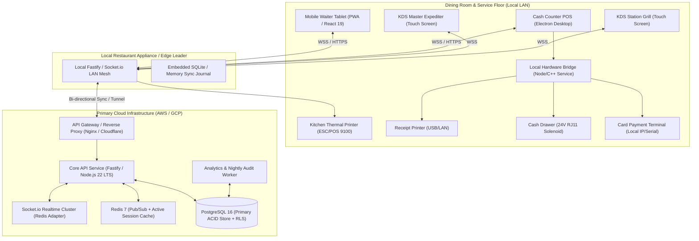
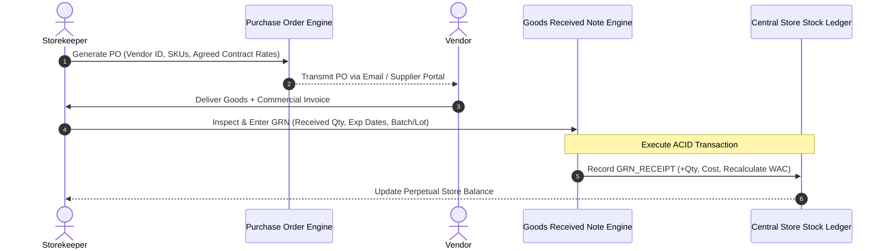
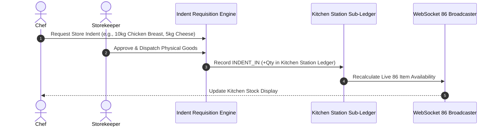
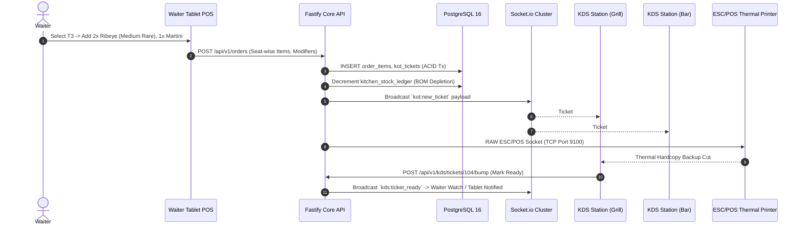
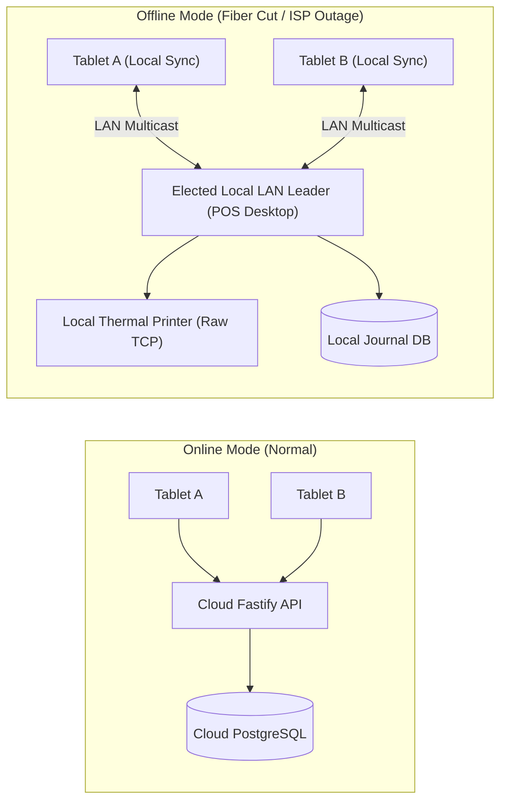
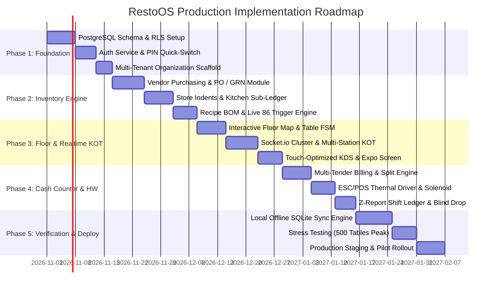

# RESTAURANT OPERATING SYSTEM (RestoOS)
## Master Implementation Plan, Technical Architecture Blueprint & Execution Roadmap

**Document Version:** 1.0.0-PROD  
**Status:** Approved for Implementation  
**Lead System Architect:** `agency-software-architect`  
**Quality & Reality Assurance Gate:** `agency-reality-checker`  
**Target System:** Multi-Tenant, High-Throughput, Offline-Resilient Restaurant Management & POS Platform

> [!IMPORTANT]
> ### V1 MVP Scope Constraint (Locked)
> * **Hardware Deployment:** Dedicated **3-Desktop Setup** running on Local LAN.
>   * **Desktop 1 (Cash Counter / Billing POS):** Bill generation, GST calculation, Cash/UPI/Card settlement, 24V cash drawer solenoid kick, 80mm thermal receipt printer, shift opening/closing (Z-Report). (Also acts as local LAN Server host).
>   * **Desktop 2 (Floor Service / Order Taking):** Waiter/captain terminal with visual table floor map, high-speed menu grid with "Veg only" toggle, dish cart, modifiers/notes, and direct "Send to Kitchen" KOT firing.
>   * **Desktop 3 (Store & Back-Office Admin):** Central Store vendor procurement (PO/GRN), Store-to-Kitchen Indents/Requisitions, Recipe BOM setup, kitchen wastage logging, menu & pricing management, and daily P&L reports.
> * **Kitchen Output:** Physical 80mm ESC/POS network thermal printer in the kitchen (prints physical KOT tickets immediately on order dispatch).
> * **Explicitly Excluded for V1:** NO Kitchen Display System (KDS), NO captain mobile phone screen, NO customer QR ordering, and NO mobile apps. Zero distraction, maximum reliability.

---

## TABLE OF CONTENTS
1. [Executive Summary & Problem Space Analysis](#1-executive-summary--problem-space-analysis)
2. [High-Level Architecture & System Topology](#2-high-level-architecture--system-topology)
3. [Technology Stack & Architectural Decisions (ADRs)](#3-technology-stack--architectural-decisions-adrs)
4. [Relational Database Schema (PostgreSQL DDL Blueprint)](#4-relational-database-schema-postgresql-ddl-blueprint)
5. [Detailed Module Breakdown & Domain Logic](#5-detailed-module-breakdown--domain-logic)
   - 5.1 [Module 1: Central Store Inventory & Vendor Purchasing](#51-module-1-central-store-inventory--vendor-purchasing)
   - 5.2 [Module 2: Kitchen Inventory & Recipe BOM Consumption](#52-module-2-kitchen-inventory--recipe-bom-consumption)
   - 5.3 [Module 3: Table Management & Floor Operations](#53-module-3-table-management--floor-operations)
   - 5.4 [Module 4: Order Taking, Modifiers & KOT/KDS Realtime Dispatch](#54-module-4-order-taking-modifiers--kotkds-realtime-dispatch)
   - 5.5 [Module 5: Cash Counter, Multi-Tender Billing & Hardware Bridge](#55-module-5-cash-counter-multi-tender-billing--hardware-bridge)
   - 5.6 [Module 6: Reporting, Food Costing & Variance Analytics](#56-module-6-reporting-food-costing--variance-analytics)
   - 5.7 [Module 7: Bar Dispense & State Excise Compliance Engine (FL-3)](#57-module-7-bar-dispense--state-excise-compliance-engine-fl-3)
6. [Offline-First Sync Engine & Fault-Tolerant LAN Architecture](#6-offline-first-sync-engine--fault-tolerant-lan-architecture)
7. [Hardware Bridge Specifications (ESC/POS & Cash Solenoids)](#7-hardware-bridge-specifications-escpos--cash-solenoids)
8. [REST & WebSocket API Specifications](#8-rest--websocket-api-specifications)
9. [Step-by-Step Phased Implementation Roadmap](#9-step-by-step-phased-implementation-roadmap)
10. [Reality-Checker Quality Gates & Acceptance Test Matrix](#10-reality-checker-quality-gates--acceptance-test-matrix)

---

## 1. EXECUTIVE SUMMARY & PROBLEM SPACE ANALYSIS

### 1.1 Industry Context & Pain Points
Modern food and beverage (F&B) operators face severe operational friction caused by fragmented legacy systems (NCR Aloha, Micros Simphony) and cloud-only modern SaaS POS platforms (Toast, Lightspeed, Clover, Petpooja). Research across Reddit communities (`r/restaurateur`, `r/KitchenConfidential`, `r/TalesFromYourServer`) and field interviews reveals five systemic failure modes:

1. **The "86-Item Lag" (OutOfStock Communication Latency):**
   - *Problem:* When the kitchen exhausts an ingredient (e.g., Prime Rib or Fresh Salmon), the chef relies on verbal shouting or a physical whiteboard. Floor waitstaff frequently ring in 86'd items 15–30 minutes after depletion.
   - *Consequence:* Guests are informed 10 minutes into their meal that their order cannot be fulfilled. Table turn times increase by 18–25 minutes, tips drop, and food waste escalates.
   - *Solution:* Sub-second, yield-derived inventory tracking where placing a KOT decrements kitchen-level sub-stock in real time. Once key raw ingredients fall below threshold, a system-wide `ITEM_86_AUTO` WebSocket event disables ordering on all floor terminals immediately.

2. **The Inventory Reconciliation Disconnect (Store vs. Kitchen vs. Plate):**
   - *Problem:* Systems treat inventory as a single flat bucket. In reality, food moves: Vendor $\rightarrow$ Central Store $\rightarrow$ Kitchen Station (Prep) $\rightarrow$ Cooked Dish $\rightarrow$ Plate/Trash. Operators cannot pinpoint whether variance stems from vendor short-shipment, prep shrinkage, over-portioning, or staff theft.
   - *Solution:* Two-tier stock architecture with distinct **Central Store Ledger** and **Kitchen Station Sub-Ledger**, interconnected via formalized Store-to-Kitchen Indents (Requisitions) and yield-factored Bill of Materials (BOM) recipe matrices.

3. **Rush-Hour POS Latency & Terminal Lock-ups:**
   - *Problem:* Cloud-native POS systems route button clicks through multi-region cloud APIs. During 8:00 PM peak dinner service, 1.5–3.0 second UI freezes occur while waiting for HTTP round-trips.
   - *Solution:* Zero-latency local optimistic state updates with sub-15ms backend response times, backed by client-side event queues and local WebSocket brokers.

4. **Payment Processing Lock-In & Predatory Fee Structures:**
   - *Problem:* Vendors like Toast lock restaurants into captive payment rails (charging up to 2.99% + $0.15/txn + hardware leases) and brick terminals if third-party gateways are attempted.
   - *Solution:* Decoupled, modular Payment Gateway Adapter supporting local EMV card machines via TCP/IP / Serial, direct UPI QR code generation, Stripe Terminal, and manual card entry with unified settlement reconciliation.

5. **Cloud Outage Vulnerabilities:**
   - *Problem:* A cloud internet drop halts the entire restaurant: KOTs fail to print, tablets freeze, cash drawers cannot open, and orders are taken on scrap paper with massive billing discrepancies.
   - *Solution:* Local-First Autonomous Node Architecture: floor terminals elect a local LAN Leader (or communicate directly via a local on-premise edge gateway) running local SQLite/Fastify, queuing mutations and printing KOTs locally with zero internet dependency, synchronizing with the cloud database upon link restoration.

---

## 2. HIGH-LEVEL ARCHITECTURE & SYSTEM TOPOLOGY



---

## 3. TECHNOLOGY STACK & ARCHITECTURAL DECISIONS (ADRs)

### 3.1 Stack Matrix

| Component | Technology | Rationale | Performance SLA |
| :--- | :--- | :--- | :--- |
| **Frontend Framework** | Next.js 15 / React 19 + TypeScript | Turbopack compilation, React Server Components for dashboards, client islands for sub-millisecond table interactions. | First Contentful Paint < 600ms |
| **Styling & Icons** | Tailwind CSS v4 + Radix UI + Lucide | Zero runtime CSS injection, deterministic utility styling, accessible dialogs/dropdowns for high-stress floor operations. | CSS Bundle < 35KB gzipped |
| **Desktop POS / Hardware Host** | Electron 33 LTS + Node-Serialport / Node-USB | Full direct low-level OS access to raw ESC/POS USB printers, serial card readers, and COM-port cash drawer kick pulses. | USB I/O latency < 10ms |
| **Backend Runtime** | Node.js 22 LTS + Fastify v4 | Lightweight event loop, pre-compiled JSON schemas (`fast-json-stringify`), high-performance routing. | P99 API Latency < 15ms |
| **Realtime Engine** | Socket.io 4.8 + Redis Streams / PubSub | Room multiplexing per kitchen station (`tenant:station:grill`), reconnect backoff, binary packet support. | Message dispatch < 10ms |
| **Primary Persistence** | PostgreSQL 16 Enterprise | ACID compliance, strict table locks (`SELECT FOR UPDATE`), JSONB for dynamic modifiers, Row-Level Security for multi-tenancy. | Read queries < 5ms, writes < 12ms |
| **Memory Cache / PubSub** | Redis 7.4 (KeyDB or Redis Cluster) | In-memory 86 item sets, ephemeral table session state, cross-instance WebSocket broadcast routing. | Redis ops < 1.2ms |
| **Local Client DB** | Dexie.js (IndexedDB wrapper) & SQLite WASM | Local order mutation journal, offline product/menu cache, zero-latency floor search. | Local reads < 2ms |

### 3.2 Architectural Decision Records (ADRs)

#### ADR-001: Fastify over Express / NestJS-over-Express
- **Context:** The restaurant cash counter and KOT dispatch cannot tolerate the 35–80ms overhead introduced by legacy Express middleware stacks during peak hours.
- **Decision:** Use Fastify with strict JSON Schema compilation via Ajv.
- **Consequences:** Endpoints achieve 3x–4x throughput of standard Express applications. Schema validation is enforced at compile time, eliminating malformed order payloads before reaching the domain layer.

#### ADR-002: Two-Tier Inventory Architecture (Central Store vs. Kitchen Sub-Stock)
- **Context:** Depleting central store inventory on every dish order causes inventory discrepancy because food is prepped in advance (e.g., 20kg of chicken sliced into 100g portions). Storekeepers lose track of what was issued to the kitchen versus what is sitting in storage.
- **Decision:** Separate raw stock into `store_stock_ledger` and `kitchen_stock_ledger`. Stock moves from Store to Kitchen via an explicit **Store Indent (Requisition)**. Orders deduct from `kitchen_stock_ledger`.
- **Consequences:** Accurate tracking of physical storage rooms versus hot-line kitchen prep. Pinpoints whether shrinkage occurs in bulk storage (theft/leakage) or in prep (portion creep/spoilage).

#### ADR-003: Idempotent Command Pipeline via `X-Idempotency-Key`
- **Context:** Flaky restaurant Wi-Fi leads to duplicate order ring-ups or double-charging bills when waiters tap "Submit Order" or "Settle Bill" multiple times under packet loss.
- **Decision:** Every order submission, bill settlement, and stock movement requires a client-generated UUIDv7 idempotency key cached in Redis with a 24-hour TTL.
- **Consequences:** Guaranteed exactly-once execution. Repeated network retries return the cached identical response without duplicating KOTs, charges, or stock deductions.

---

## 4. RELATIONAL DATABASE SCHEMA (POSTGRESQL DDL BLUEPRINT)

```sql
-- ============================================================================
-- RESTAURANT MANAGEMENT SYSTEM - CORE POSTGRESQL SCHEMA (DDL)
-- Multi-Tenant, ACID Inventory, Multi-Station KOT, Split Billing
-- ============================================================================

CREATE EXTENSION IF NOT EXISTS "uuid-ossp";
CREATE EXTENSION IF NOT EXISTS "citext";

-- ----------------------------------------------------------------------------
-- 1. MULTI-TENANCY & RBAC
-- ----------------------------------------------------------------------------
CREATE TABLE tenants (
    id UUID PRIMARY KEY DEFAULT gen_random_uuid(),
    name VARCHAR(120) NOT NULL,
    subdomain VARCHAR(63) NOT NULL UNIQUE,
    currency VARCHAR(3) NOT NULL DEFAULT 'USD',
    tax_identifier VARCHAR(50),
    is_active BOOLEAN NOT NULL DEFAULT TRUE,
    created_at TIMESTAMPTZ NOT NULL DEFAULT CURRENT_TIMESTAMP,
    updated_at TIMESTAMPTZ NOT NULL DEFAULT CURRENT_TIMESTAMP
);

CREATE TYPE user_role AS ENUM ('ADMIN', 'STOREKEEPER', 'CHEF', 'WAITER', 'CASHIER', 'MANAGER');

CREATE TABLE users (
    id UUID PRIMARY KEY DEFAULT gen_random_uuid(),
    tenant_id UUID NOT NULL REFERENCES tenants(id) ON DELETE CASCADE,
    username VARCHAR(50) NOT NULL,
    email CITEXT NOT NULL,
    password_hash VARCHAR(255) NOT NULL,
    pin_hash VARCHAR(255) NOT NULL, -- 4-to-6 digit floor quick login
    role user_role NOT NULL,
    full_name VARCHAR(100) NOT NULL,
    is_active BOOLEAN NOT NULL DEFAULT TRUE,
    created_at TIMESTAMPTZ NOT NULL DEFAULT CURRENT_TIMESTAMP,
    CONSTRAINT uq_tenant_user UNIQUE(tenant_id, username),
    CONSTRAINT uq_tenant_email UNIQUE(tenant_id, email)
);

-- ----------------------------------------------------------------------------
-- 2. INVENTORY & VENDOR PURCHASING (CENTRAL STORE)
-- ----------------------------------------------------------------------------
CREATE TYPE unit_of_measure AS ENUM ('KG', 'GRAM', 'LITER', 'ML', 'PIECE', 'CAN', 'PACKET');

CREATE TABLE raw_materials (
    id UUID PRIMARY KEY DEFAULT gen_random_uuid(),
    tenant_id UUID NOT NULL REFERENCES tenants(id) ON DELETE CASCADE,
    sku VARCHAR(40) NOT NULL,
    name VARCHAR(120) NOT NULL,
    category VARCHAR(50) NOT NULL, -- e.g. Meat, Dairy, Produce, Dry Goods
    uom unit_of_measure NOT NULL,
    reorder_level NUMERIC(12, 3) NOT NULL DEFAULT 5.000,
    cost_per_unit NUMERIC(12, 4) NOT NULL DEFAULT 0.0000, -- Weighted Average Cost
    created_at TIMESTAMPTZ NOT NULL DEFAULT CURRENT_TIMESTAMP,
    CONSTRAINT uq_tenant_sku UNIQUE (tenant_id, sku)
);

CREATE TABLE vendors (
    id UUID PRIMARY KEY DEFAULT gen_random_uuid(),
    tenant_id UUID NOT NULL REFERENCES tenants(id) ON DELETE CASCADE,
    name VARCHAR(150) NOT NULL,
    contact_name VARCHAR(100),
    phone VARCHAR(30) NOT NULL,
    email CITEXT,
    gst_or_tax_no VARCHAR(50),
    payment_terms VARCHAR(50) DEFAULT 'Net 30',
    is_active BOOLEAN NOT NULL DEFAULT TRUE,
    created_at TIMESTAMPTZ NOT NULL DEFAULT CURRENT_TIMESTAMP
);

CREATE TABLE purchase_orders (
    id UUID PRIMARY KEY DEFAULT gen_random_uuid(),
    tenant_id UUID NOT NULL REFERENCES tenants(id) ON DELETE CASCADE,
    po_number VARCHAR(40) NOT NULL,
    vendor_id UUID NOT NULL REFERENCES vendors(id),
    status VARCHAR(20) NOT NULL DEFAULT 'DRAFT', -- DRAFT, APPROVED, ORDERED, RECEIVED, CANCELLED
    expected_delivery DATE,
    total_amount NUMERIC(12, 2) NOT NULL DEFAULT 0.00,
    notes TEXT,
    created_by UUID NOT NULL REFERENCES users(id),
    created_at TIMESTAMPTZ NOT NULL DEFAULT CURRENT_TIMESTAMP,
    CONSTRAINT uq_tenant_po UNIQUE (tenant_id, po_number)
);

CREATE TABLE po_items (
    id UUID PRIMARY KEY DEFAULT gen_random_uuid(),
    po_id UUID NOT NULL REFERENCES purchase_orders(id) ON DELETE CASCADE,
    raw_material_id UUID NOT NULL REFERENCES raw_materials(id),
    ordered_qty NUMERIC(12, 3) NOT NULL,
    unit_price NUMERIC(12, 4) NOT NULL,
    total_price NUMERIC(12, 2) NOT NULL
);

CREATE TABLE goods_received_notes (
    id UUID PRIMARY KEY DEFAULT gen_random_uuid(),
    tenant_id UUID NOT NULL REFERENCES tenants(id) ON DELETE CASCADE,
    grn_number VARCHAR(40) NOT NULL,
    po_id UUID REFERENCES purchase_orders(id),
    vendor_id UUID NOT NULL REFERENCES vendors(id),
    vendor_invoice_no VARCHAR(60),
    received_date TIMESTAMPTZ NOT NULL DEFAULT CURRENT_TIMESTAMP,
    received_by UUID NOT NULL REFERENCES users(id),
    total_invoiced_amount NUMERIC(12, 2) NOT NULL,
    created_at TIMESTAMPTZ NOT NULL DEFAULT CURRENT_TIMESTAMP,
    CONSTRAINT uq_tenant_grn UNIQUE (tenant_id, grn_number)
);

CREATE TABLE grn_items (
    id UUID PRIMARY KEY DEFAULT gen_random_uuid(),
    grn_id UUID NOT NULL REFERENCES goods_received_notes(id) ON DELETE CASCADE,
    raw_material_id UUID NOT NULL REFERENCES raw_materials(id),
    received_qty NUMERIC(12, 3) NOT NULL,
    rejected_qty NUMERIC(12, 3) NOT NULL DEFAULT 0.000,
    accepted_qty NUMERIC(12, 3) NOT NULL,
    unit_cost NUMERIC(12, 4) NOT NULL,
    batch_lot_number VARCHAR(50),
    expiry_date DATE
);

-- Store Stock Ledger (Perpetual Inventory Audit Log)
CREATE TABLE store_stock_ledger (
    id UUID PRIMARY KEY DEFAULT gen_random_uuid(),
    tenant_id UUID NOT NULL REFERENCES tenants(id) ON DELETE CASCADE,
    raw_material_id UUID NOT NULL REFERENCES raw_materials(id),
    transaction_type VARCHAR(30) NOT NULL, -- 'GRN_RECEIPT', 'INDENT_OUT', 'STORE_ADJUSTMENT', 'RETURN'
    reference_id UUID,                     -- points to grn_id or indent_id
    qty_in NUMERIC(12, 3) NOT NULL DEFAULT 0.000,
    qty_out NUMERIC(12, 3) NOT NULL DEFAULT 0.000,
    balance_qty NUMERIC(12, 3) NOT NULL,
    unit_rate NUMERIC(12, 4) NOT NULL,
    created_at TIMESTAMPTZ NOT NULL DEFAULT CURRENT_TIMESTAMP
);
CREATE INDEX idx_store_ledger_tenant_mat ON store_stock_ledger(tenant_id, raw_material_id, created_at DESC);

-- ----------------------------------------------------------------------------
-- 3. KITCHEN INVENTORY & STORE INDENTS (STORE-TO-KITCHEN REQUISITIONS)
-- ----------------------------------------------------------------------------
CREATE TABLE store_indents (
    id UUID PRIMARY KEY DEFAULT gen_random_uuid(),
    tenant_id UUID NOT NULL REFERENCES tenants(id) ON DELETE CASCADE,
    indent_number VARCHAR(40) NOT NULL,
    station_name VARCHAR(50) NOT NULL, -- e.g. Main Kitchen, Grill, Pastry, Bar
    status VARCHAR(20) NOT NULL DEFAULT 'REQUESTED', -- 'REQUESTED', 'ISSUED', 'REJECTED'
    requested_by UUID NOT NULL REFERENCES users(id),
    issued_by UUID REFERENCES users(id),
    requested_at TIMESTAMPTZ NOT NULL DEFAULT CURRENT_TIMESTAMP,
    issued_at TIMESTAMPTZ,
    CONSTRAINT uq_tenant_indent UNIQUE (tenant_id, indent_number)
);

CREATE TABLE indent_items (
    id UUID PRIMARY KEY DEFAULT gen_random_uuid(),
    indent_id UUID NOT NULL REFERENCES store_indents(id) ON DELETE CASCADE,
    raw_material_id UUID NOT NULL REFERENCES raw_materials(id),
    requested_qty NUMERIC(12, 3) NOT NULL,
    issued_qty NUMERIC(12, 3) NOT NULL DEFAULT 0.000
);

-- Kitchen Sub-Ledger (Real-time prep stock consumed by KOTs)
CREATE TABLE kitchen_stock_ledger (
    id UUID PRIMARY KEY DEFAULT gen_random_uuid(),
    tenant_id UUID NOT NULL REFERENCES tenants(id) ON DELETE CASCADE,
    raw_material_id UUID NOT NULL REFERENCES raw_materials(id),
    transaction_type VARCHAR(30) NOT NULL, -- 'INDENT_IN', 'KOT_DEPLETION', 'KITCHEN_WASTE', 'AUDIT_CORRECTION'
    reference_id UUID,                     -- points to indent_id, order_id, or waste_id
    qty_in NUMERIC(12, 3) NOT NULL DEFAULT 0.000,
    qty_out NUMERIC(12, 3) NOT NULL DEFAULT 0.000,
    current_kitchen_balance NUMERIC(12, 3) NOT NULL,
    created_at TIMESTAMPTZ NOT NULL DEFAULT CURRENT_TIMESTAMP
);
CREATE INDEX idx_kitchen_ledger ON kitchen_stock_ledger(tenant_id, raw_material_id, created_at DESC);

-- ----------------------------------------------------------------------------
-- 4. MENU ENGINEERING & RECIPE BILL OF MATERIALS (BOM)
-- ----------------------------------------------------------------------------
CREATE TABLE menu_categories (
    id UUID PRIMARY KEY DEFAULT gen_random_uuid(),
    tenant_id UUID NOT NULL REFERENCES tenants(id) ON DELETE CASCADE,
    name VARCHAR(80) NOT NULL,
    display_order INT NOT NULL DEFAULT 0,
    is_active BOOLEAN NOT NULL DEFAULT TRUE
);

CREATE TABLE menu_items (
    id UUID PRIMARY KEY DEFAULT gen_random_uuid(),
    tenant_id UUID NOT NULL REFERENCES tenants(id) ON DELETE CASCADE,
    category_id UUID NOT NULL REFERENCES menu_categories(id),
    sku VARCHAR(40) NOT NULL,
    name VARCHAR(120) NOT NULL,
    description TEXT,
    base_price NUMERIC(10, 2) NOT NULL,
    kitchen_station VARCHAR(40) NOT NULL DEFAULT 'GRILL', -- 'GRILL', 'FRY', 'PANTRY', 'BAR'
    tax_rate NUMERIC(5, 2) NOT NULL DEFAULT 5.00,        -- Percentage
    is_available BOOLEAN NOT NULL DEFAULT TRUE,          -- Dynamic manual or auto-86 flag
    is_auto_86_enabled BOOLEAN NOT NULL DEFAULT TRUE,
    created_at TIMESTAMPTZ NOT NULL DEFAULT CURRENT_TIMESTAMP,
    CONSTRAINT uq_tenant_menu_sku UNIQUE(tenant_id, sku)
);

CREATE TABLE recipe_bom (
    id UUID PRIMARY KEY DEFAULT gen_random_uuid(),
    menu_item_id UUID NOT NULL REFERENCES menu_items(id) ON DELETE CASCADE,
    raw_material_id UUID NOT NULL REFERENCES raw_materials(id),
    consumption_qty NUMERIC(12, 4) NOT NULL, -- Amount in material's UOM
    shrinkage_factor NUMERIC(5, 2) NOT NULL DEFAULT 1.00, -- 1.05 = 5% prep waste
    is_critical_for_86 BOOLEAN NOT NULL DEFAULT TRUE,     -- If 0 in kitchen, mark item 86'd
    CONSTRAINT uq_menu_material UNIQUE(menu_item_id, raw_material_id)
);

CREATE TABLE modifier_groups (
    id UUID PRIMARY KEY DEFAULT gen_random_uuid(),
    tenant_id UUID NOT NULL REFERENCES tenants(id) ON DELETE CASCADE,
    name VARCHAR(80) NOT NULL,
    min_selection INT NOT NULL DEFAULT 0,
    max_selection INT NOT NULL DEFAULT 1,
    is_required BOOLEAN NOT NULL DEFAULT FALSE
);

CREATE TABLE modifier_options (
    id UUID PRIMARY KEY DEFAULT gen_random_uuid(),
    group_id UUID NOT NULL REFERENCES modifier_groups(id) ON DELETE CASCADE,
    name VARCHAR(80) NOT NULL,
    price_delta NUMERIC(10, 2) NOT NULL DEFAULT 0.00,
    raw_material_id UUID REFERENCES raw_materials(id),
    consumption_qty NUMERIC(12, 4) DEFAULT 0.000
);

-- ----------------------------------------------------------------------------
-- 5. FLOOR MANAGEMENT & TABLES
-- ----------------------------------------------------------------------------
CREATE TYPE table_status AS ENUM ('AVAILABLE', 'OCCUPIED', 'ORDERED', 'BILLED', 'CLEANING');

CREATE TABLE dining_tables (
    id UUID PRIMARY KEY DEFAULT gen_random_uuid(),
    tenant_id UUID NOT NULL REFERENCES tenants(id) ON DELETE CASCADE,
    section_name VARCHAR(50) NOT NULL DEFAULT 'Main Dining',
    table_number VARCHAR(20) NOT NULL,
    capacity INT NOT NULL DEFAULT 4,
    status table_status NOT NULL DEFAULT 'AVAILABLE',
    current_guest_count INT DEFAULT 0,
    pos_x INT NOT NULL DEFAULT 0, -- Canvas coordinates
    pos_y INT NOT NULL DEFAULT 0,
    assigned_waiter_id UUID REFERENCES users(id),
    created_at TIMESTAMPTZ NOT NULL DEFAULT CURRENT_TIMESTAMP,
    CONSTRAINT uq_tenant_table_num UNIQUE(tenant_id, section_name, table_number)
);

CREATE TABLE table_sessions (
    id UUID PRIMARY KEY DEFAULT gen_random_uuid(),
    tenant_id UUID NOT NULL REFERENCES tenants(id) ON DELETE CASCADE,
    table_id UUID NOT NULL REFERENCES dining_tables(id),
    guest_count INT NOT NULL,
    opened_by UUID NOT NULL REFERENCES users(id),
    opened_at TIMESTAMPTZ NOT NULL DEFAULT CURRENT_TIMESTAMP,
    closed_at TIMESTAMPTZ,
    status VARCHAR(20) NOT NULL DEFAULT 'ACTIVE' -- 'ACTIVE', 'COMPLETED'
);

-- ----------------------------------------------------------------------------
-- 6. ORDERS & KITCHEN ORDER TICKETS (KOT / KDS)
-- ----------------------------------------------------------------------------
CREATE TYPE order_status AS ENUM ('OPEN', 'SENT_TO_KITCHEN', 'PARTIALLY_READY', 'SERVED', 'BILLED', 'VOID');
CREATE TYPE kot_status AS ENUM ('QUEUED', 'PREPARING', 'READY', 'BUMPED', 'RECALLED');

CREATE TABLE orders (
    id UUID PRIMARY KEY DEFAULT gen_random_uuid(),
    tenant_id UUID NOT NULL REFERENCES tenants(id) ON DELETE CASCADE,
    order_number VARCHAR(40) NOT NULL,
    table_id UUID NOT NULL REFERENCES dining_tables(id),
    session_id UUID NOT NULL REFERENCES table_sessions(id),
    waiter_id UUID NOT NULL REFERENCES users(id),
    status order_status NOT NULL DEFAULT 'OPEN',
    subtotal NUMERIC(12, 2) NOT NULL DEFAULT 0.00,
    tax_total NUMERIC(12, 2) NOT NULL DEFAULT 0.00,
    discount_total NUMERIC(12, 2) NOT NULL DEFAULT 0.00,
    final_amount NUMERIC(12, 2) NOT NULL DEFAULT 0.00,
    created_at TIMESTAMPTZ NOT NULL DEFAULT CURRENT_TIMESTAMP,
    updated_at TIMESTAMPTZ NOT NULL DEFAULT CURRENT_TIMESTAMP,
    CONSTRAINT uq_tenant_order_num UNIQUE(tenant_id, order_number)
);

CREATE TABLE kot_tickets (
    id UUID PRIMARY KEY DEFAULT gen_random_uuid(),
    tenant_id UUID NOT NULL REFERENCES tenants(id) ON DELETE CASCADE,
    order_id UUID NOT NULL REFERENCES orders(id) ON DELETE CASCADE,
    kot_sequence INT NOT NULL, -- KOT-1, KOT-2 for running tables
    station VARCHAR(40) NOT NULL, -- e.g. GRILL, BAR, FRY
    status kot_status NOT NULL DEFAULT 'QUEUED',
    printed_at TIMESTAMPTZ,
    fired_at TIMESTAMPTZ NOT NULL DEFAULT CURRENT_TIMESTAMP,
    bumped_at TIMESTAMPTZ
);

CREATE TABLE order_items (
    id UUID PRIMARY KEY DEFAULT gen_random_uuid(),
    order_id UUID NOT NULL REFERENCES orders(id) ON DELETE CASCADE,
    kot_id UUID REFERENCES kot_tickets(id),
    menu_item_id UUID NOT NULL REFERENCES menu_items(id),
    seat_number INT DEFAULT 1,
    course_number INT DEFAULT 1, -- 1: Appetizer, 2: Main, 3: Dessert
    quantity INT NOT NULL,
    unit_price NUMERIC(10, 2) NOT NULL,
    total_price NUMERIC(10, 2) NOT NULL,
    special_notes TEXT,
    is_void BOOLEAN NOT NULL DEFAULT FALSE,
    void_reason TEXT,
    created_at TIMESTAMPTZ NOT NULL DEFAULT CURRENT_TIMESTAMP
);

CREATE TABLE order_item_modifiers (
    id UUID PRIMARY KEY DEFAULT gen_random_uuid(),
    order_item_id UUID NOT NULL REFERENCES order_items(id) ON DELETE CASCADE,
    modifier_option_id UUID NOT NULL REFERENCES modifier_options(id),
    price_delta NUMERIC(10, 2) NOT NULL DEFAULT 0.00
);

-- ----------------------------------------------------------------------------
-- 7. BILLING, SPLIT PAYMENTS & CASH REGISTER (Z-REPORT)
-- ----------------------------------------------------------------------------
CREATE TABLE cash_shifts (
    id UUID PRIMARY KEY DEFAULT gen_random_uuid(),
    tenant_id UUID NOT NULL REFERENCES tenants(id) ON DELETE CASCADE,
    cashier_id UUID NOT NULL REFERENCES users(id),
    terminal_id VARCHAR(50) NOT NULL,
    opened_at TIMESTAMPTZ NOT NULL DEFAULT CURRENT_TIMESTAMP,
    closed_at TIMESTAMPTZ,
    opening_float NUMERIC(12, 2) NOT NULL,
    closing_counted_cash NUMERIC(12, 2),
    expected_cash NUMERIC(12, 2),
    cash_variance NUMERIC(12, 2),
    status VARCHAR(20) NOT NULL DEFAULT 'OPEN' -- 'OPEN', 'CLOSED'
);

CREATE TABLE bills (
    id UUID PRIMARY KEY DEFAULT gen_random_uuid(),
    tenant_id UUID NOT NULL REFERENCES tenants(id) ON DELETE CASCADE,
    bill_number VARCHAR(40) NOT NULL,
    order_id UUID NOT NULL REFERENCES orders(id),
    shift_id UUID NOT NULL REFERENCES cash_shifts(id),
    subtotal NUMERIC(12, 2) NOT NULL,
    tax_amount NUMERIC(12, 2) NOT NULL,
    discount_amount NUMERIC(12, 2) NOT NULL DEFAULT 0.00,
    service_charge NUMERIC(12, 2) NOT NULL DEFAULT 0.00,
    rounding_adjustment NUMERIC(6, 2) NOT NULL DEFAULT 0.00,
    grand_total NUMERIC(12, 2) NOT NULL,
    is_settled BOOLEAN NOT NULL DEFAULT FALSE,
    settled_at TIMESTAMPTZ,
    created_at TIMESTAMPTZ NOT NULL DEFAULT CURRENT_TIMESTAMP,
    CONSTRAINT uq_tenant_bill_num UNIQUE(tenant_id, bill_number)
);

CREATE TYPE tender_type AS ENUM ('CASH', 'CREDIT_CARD', 'DEBIT_CARD', 'UPI_QR', 'ROOM_TAB', 'GIFT_CARD');

CREATE TABLE bill_settlements (
    id UUID PRIMARY KEY DEFAULT gen_random_uuid(),
    bill_id UUID NOT NULL REFERENCES bills(id) ON DELETE CASCADE,
    tender tender_type NOT NULL,
    amount NUMERIC(12, 2) NOT NULL,
    tender_reference VARCHAR(100), -- Card auth code, UPI txn ID
    tender_timestamp TIMESTAMPTZ NOT NULL DEFAULT CURRENT_TIMESTAMP
);

CREATE TABLE wastage_logs (
    id UUID PRIMARY KEY DEFAULT gen_random_uuid(),
    tenant_id UUID NOT NULL REFERENCES tenants(id) ON DELETE CASCADE,
    raw_material_id UUID REFERENCES raw_materials(id),
    menu_item_id UUID REFERENCES menu_items(id),
    quantity NUMERIC(12, 3) NOT NULL,
    waste_reason VARCHAR(100) NOT NULL, -- 'EXPIRED', 'BURNT_IN_PREP', 'DROPPED', 'CUSTOMER_RETURN'
    cost_impact NUMERIC(12, 2) NOT NULL,
    reported_by UUID NOT NULL REFERENCES users(id),
    logged_at TIMESTAMPTZ NOT NULL DEFAULT CURRENT_TIMESTAMP
);
```

---

## 5. DETAILED MODULE BREAKDOWN & DOMAIN LOGIC

### 5.1 Module 1: Central Store Inventory & Vendor Purchasing


- **Perpetual Cost Calculation:** The system executes Weighted Average Costing (WAC) upon every GRN commit:
  $$\text{WAC}_{\text{new}} = \frac{(\text{Current Qty} \times \text{Current WAC}) + (\text{Received Qty} \times \text{Invoice Unit Cost})}{\text{Current Qty} + \text{Received Qty}}$$
- **Purchase Price Variance (PPV):** If invoice cost differs from the vendor catalog rate by $> \pm 3\%$, the GRN flags an audit alert requiring manager override.
- **Minimum Stock Alerts:** Central Store runs a cron and trigger-based evaluation. If `balance_qty <= reorder_level`, an automated draft PO is staged.

---

### 5.2 Module 2: Kitchen Inventory & Recipe BOM Consumption


- **Two-Level Recipe BOM Structure:**
  - *Prep/Sub-Recipe:* Pre-cooked items (e.g., Marinara Sauce batch). Tracks raw tomatoes + olive oil + herbs $\times$ yield factor (accounting for evaporation reduction).
  - *Finished Menu Item:* 1x Pizza Margherita de-accumulates 180g Pizza Dough, 90g Marinara Sauce, 120g Fresh Mozzarella.
- **The Live "86" Auto-Calculation Engine:**
  - For any menu item $M$, its availability $A(M)$ is calculated dynamically:
    $$A(M) = \min_{r \in \text{BOM}(M)} \left( \left\lfloor \frac{\text{KitchenBalance}(r)}{\text{Consumption}(r) \times \text{Shrinkage}(r)} \right\rfloor \right)$$
  - Where $r$ represents critical raw materials flagged with `is_critical_for_86 = TRUE`.
  - When $A(M) == 0$, the server emits:
    ```json
    {
      "event": "ITEM_86_AUTO",
      "tenant_id": "7f000001-8b20-1a00-818b-201a00b20000",
      "menu_item_id": "90e2418a-4efb-4191-8fa1-7171e220f121",
      "sku": "MAIN-RIBEYE-350G",
      "status": "OUT_OF_STOCK",
      "limiting_ingredient": "Raw Wagyu Ribeye",
      "timestamp": "2026-10-26T20:14:02.124Z"
    }
    ```
  - Floor tablets receive this packet and gray out the button within $\le 50\text{ms}$. Waiters physically cannot select or ring the item.

---

### 5.3 Module 3: Table Management & Floor Operations

```
+-----------------------------------------------------------------------------------+
| TABLE FLOOR MAP (Main Dining Zone)                                  [+ Add Table] |
+-----------------------------------------------------------------------------------+
|  [ T1 (4) ]           [ T2 (2) ]           [ T3 (6) ]           [ T4 (4) ]        |
|  AVAILABLE            OCCUPIED             ORDERED              BILLED            |
|  $0.00                $74.50 (28m)         $142.00 (14m)        $89.20 (42m)      |
|  (Green)              (Red - John W.)      (Blue - Prep)        (Amber - Settle)  |
|                                                                                   |
|  [ T5 (8) ]           [ T6 (4) ]           [ T7 (2) ]           [ T8 (4) ]        |
|  CLEANING             OCCUPIED             AVAILABLE            OCCUPIED          |
|  (Purple)             $210.00 (52m)        $0.00                $45.00 (10m)      |
+-----------------------------------------------------------------------------------+
```

- **Table Finite State Machine (FSM):**
  $$\text{AVAILABLE} \xrightarrow{\text{Open Table (Covers)}} \text{OCCUPIED} \xrightarrow{\text{KOT Dispatched}} \text{ORDERED} \xrightarrow{\text{Print Bill}} \text{BILLED} \xrightarrow{\text{Payment Settle}} \text{CLEANING} \xrightarrow{\text{Bus Boy Clear}} \text{AVAILABLE}$$
- **Atomic Table Merging & Splitting:**
  - *Table Merge:* Moving Table 5 into Table 4 retains order history under a single master bill while setting Table 5 status to `OCCUPIED_LINKED(T4)`.
  - *Table Transfer:* Moving party from Table 2 (Bar) to Table 12 (Dining Room) updates table foreign keys in `orders` and `table_sessions` atomically via database transaction, broadcasting new coordinates to floor staff.

---

### 5.4 Module 4: Order Taking, Modifiers & KOT/KDS Realtime Dispatch



- **Multi-Station Smart Splitting:**
  Every menu item has an assigned `kitchen_station` attribute (e.g., `GRILL`, `FRY`, `PANTRY`, `BAR`). When an order containing a Steak, a Caesar Salad, and two Cocktails is submitted:
  - System splits the single order into three atomic KOT tickets: `KOT-A (Grill)`, `KOT-B (Pantry)`, `KOT-C (Bar)`.
  - Station KDS screens render solely their respective items, while the **Master Expediter (Expo) Screen** aggregates all three tickets under a unified status bar with dish synchronization indicators.

---

### 5.5 Module 5: Cash Counter, Multi-Tender Billing & Hardware Bridge

- **Split-Bill Engine:**
  - *Split by Seat:* Queries `order_items` partitioned by `seat_number`, generating distinct sub-bills with proportional shared charges (service charge + tax).
  - *Equal Split (N-Way):* Divides grand total by $N$. If un-even penny rounding occurs (e.g., $100.00 \div 3 = 33.333...$), the first bill absorbs the $\$0.01$ rounding adjustment:
    $$\text{Bill}_1 = \$33.34, \quad \text{Bill}_2 = \$33.33, \quad \text{Bill}_3 = \$33.33$$
- **Shift Reconciliation (X-Report vs. Z-Report):**
  - *X-Report:* On-demand mid-shift balance read without resetting shift counters.
  - *Z-Report:* Formal end-of-shift register closure. Blind drop verification requires the cashier to enter physical counted currency *before* displaying expected server totals. System records cash overage/shortage:
    $$\text{Variance} = \text{Counted Cash} - (\text{Opening Float} + \sum \text{Cash Sales} - \sum \text{Paid Outs})$$
  - Generates immutable Z-Record, resets daily sequence counters, and fires drawer kick.

---

### 5.6 Module 6: Reporting, Food Costing & Variance Analytics

- **Actual vs. Theoretical (AvT) Food Cost Engine:**
  - *Theoretical Cost:*
    $$\text{Theoretical Cost} = \sum (\text{Quantity of Dish Sold} \times \text{BOM Recipe Cost})$$
  - *Actual Cost:*
    $$\text{Actual Cost} = (\text{Opening Inventory Value} + \text{Purchases / GRN}) - \text{Ending Inventory Value}$$
  - *Variance Analysis:*
    $$\text{Variance (\$)} = \text{Actual Cost} - \text{Theoretical Cost}$$
    $$\text{Variance (\%)} = \frac{\text{Variance (\Store Cost)}}{\text{Total Sales}} \times 100$$
  - Discrepancies $> 1.5\%$ trigger drill-down reports highlighting specific raw ingredient shrinkage.

- **Menu Engineering Matrix (BCG / Miller-Matrix):**
  Calculates Item Profitability (Margin) vs. Popularity (Sales Volume) relative to category averages:
  - **Stars (High Margin, High Volume):** Maintain consistency, prime floor visibility.
  - **Plowhorses (Low Margin, High Volume):** High popularity, low profit; re-engineer recipe BOM or increase price incrementally.
  - **Puzzles (High Margin, Low Volume):** Reposition on menu, incentivize servers to promote.
  - **Dogs (Low Margin, Low Volume):** Candidates for 86 / immediate menu retirement.

---

### 5.7 Module 7: Bar Dispense & State Excise Compliance Engine (FL-3)

- **Constitutional Dual Taxation (GST vs. State VAT):**
  - Liquor is strictly constitutionally excluded from GST (Article 366(12A)).
  - Food items attract 5% GST (2.5% CGST + 2.5% SGST); alcoholic beverages attract State VAT (MVAT 5%/10%).
  - Billing engine handles single-slip dual-tax calculation or auto-split invoices (Food Tax Invoice vs. Bar Cash Memo).
- **Peg-Wise Inventory Deduction & Open Bottle Tracking:**
  - Converts wholesale bottles (750ml, 1000ml) into dispense units: 30ml (Small Peg), 60ml (Large/Patiala Peg), 90ml, Wine Glass (150ml), Beer (650ml/330ml/can), and Draught Kegs (30L/50L in ml).
  - Maintains separate sealed godown stock and active open-bottle counter rail balance.
- **Mandatory State Excise Registers & Statutory Returns:**
  - **Form FLR-3 & FLR-3A:** Daily brand-wise and size-wise stock & sales ledger ($\text{Opening} + \text{Inward TP} - \text{Sales} - \text{Breakage} = \text{Closing}$) generated dynamically before day close.
  - **Transport Permit (TP) Inward Ledger:** Tracks authorized wholesale shipments (FL-1), permit numbers, vehicle numbers, batch codes, and excise holograms.
  - **Form FLR-4 Monthly Return:** Consolidated monthly return filed with the District State Excise Office by the 7th of every month.
  - **Breakage / Spoilage Log:** Dropped bottles or draft line purges recorded with supervisor PIN sign-off.
- **Smart Order Routing (BOT vs. KOT):**
  - Food items automatically route to the Kitchen Thermal Printer (KOT); alcoholic drinks route to the Bar Dispense Printer (BOT).
- **Statutory Safeguards:**
  - Automated Dry Day Lockout preventing alcohol sales on national/religious/election dry days.
  - Legal Drinking Age verification (MLDA 21/25 yrs) on bar orders.

---

## 6. OFFLINE-FIRST SYNC ENGINE & FAULT-TOLERANT LAN ARCHITECTURE

### 6.1 The "Zero-Downtime Restaurant" Guarantee
Commercial restaurants cannot stop ringing food because an ISP fiber line was severed. RestoOS implements a Local Autonomous Mesh:



### 6.2 Conflict-Free Replay Protocol
1. **Local Mutation Journal:** Every local action is saved into an IndexedDB / SQLite append-only log with a monotonically increasing client sequence number and UUIDv7.
2. **Deterministic Conflict Resolution Matrix:**
   - *Orders & KOTs:* Cumulative Append. If Tablet A adds Soup and Tablet B adds Salad to Table 4 offline, both order items are merged cleanly upon cloud sync.
   - *Bill Settlement:* Single Authority. The cash counter terminal holds exclusive write lease for billing. No two terminals can settle the same bill concurrently.
   - *Inventory Depletion:* Master Ledger Adjustment. Offline consumption is queued and replayed against the database in timestamp order using `FOR UPDATE` row locks.

---

## 7. HARDWARE BRIDGE SPECIFICATIONS (ESC/POS & CASH SOLENOIDS)

### 7.1 Direct Raw ESC/POS Receipt Printing via Port 9100 / USB
The local POS service (Node.js/Electron) establishes raw socket connections directly to thermal receipt printers (Epson TM-T88VI/VII, Star TSP143, Bixolon SRP-350):

```typescript
import * as net from 'net';

export class ThermalPrinterBridge {
  private readonly ESC = 0x1b;
  private readonly GS = 0x1d;

  /**
   * Generates low-level ESC/POS byte buffer for instant thermal cut
   */
  public buildKOTBuffer(kotData: {
    ticketNumber: string;
    table: string;
    waiter: string;
    items: Array<{ name: string; qty: number; notes?: string }>;
  }): Buffer {
    const commands: number[] = [
      this.ESC, 0x40,             // Initialize printer
      this.ESC, 0x61, 0x01,       // Center alignment
      this.GS,  0x21, 0x11,       // Double height & width mode
    ];

    // Push Ticket Header
    commands.push(...Buffer.from(`*** KOT #${kotData.ticketNumber} ***\n`));
    commands.push(this.ESC, 0x21, 0x00); // Standard font
    commands.push(...Buffer.from(`TABLE: ${kotData.table} | WAITER: ${kotData.waiter}\n`));
    commands.push(...Buffer.from(`TIME: ${new Date().toLocaleTimeString()}\n`));
    commands.push(...Buffer.from('------------------------------------------\n'));
    
    // Left Align Items
    commands.push(this.ESC, 0x61, 0x00);
    for (const item of kotData.items) {
      commands.push(this.ESC, 0x45, 0x01); // Bold on
      commands.push(...Buffer.from(`${item.qty}x ${item.name}\n`));
      commands.push(this.ESC, 0x45, 0x00); // Bold off
      if (item.notes) {
        commands.push(...Buffer.from(`   >> NOTE: ${item.notes}\n`));
      }
    }
    commands.push(...Buffer.from('------------------------------------------\n\n\n'));

    // Cut Command (GS V 66 0: Partial Cut with Feed)
    commands.push(this.GS, 0x56, 0x42, 0x00);

    return Buffer.from(commands);
  }

  /**
   * Dispatches 24V pulse to RJ11 Cash Drawer Solenoid
   */
  public generateCashDrawerKickPulse(): Buffer {
    // ESC p m t1 t2 (Pin 2: m=0, t1=50ms pulse on, t2=50ms pulse off)
    return Buffer.from([this.ESC, 0x70, 0x00, 0x19, 0xfa]);
  }

  public async printDirectTCP(ip: string, port = 9100, payload: Buffer): Promise<void> {
    return new Promise((resolve, reject) => {
      const socket = new net.Socket();
      socket.setTimeout(2500); // Strict 2.5s network timeout
      socket.connect(port, ip, () => {
        socket.write(payload, () => {
          socket.end();
          resolve();
        });
      });
      socket.on('error', (err) => reject(err));
      socket.on('timeout', () => {
        socket.destroy();
        reject(new Error(`Thermal printer connection timed out at ${ip}:${port}`));
      });
    });
  }
}
```

---

## 8. REST & WEBSOCKET API SPECIFICATIONS

All endpoints conform to **RFC 7807 (Problem Details for HTTP APIs)** for error models.

### 8.1 Authentication & Fast-Switch PIN Login
#### `POST /api/v1/auth/pin-login`
Rapid floor switch for shared waiter/cashier POS terminals.
- **Request:**
  ```json
  {
    "tenant_id": "7f000001-8b20-1a00-818b-201a00b20000",
    "pin": "4829",
    "terminal_id": "POS-MAIN-01"
  }
  ```
- **Response (`200 OK`):**
  ```json
  {
    "access_token": "eyJhbGciOiJIUzI1NiIsInR5cCI6IkpXVCJ9...",
    "expires_in": 28800,
    "user": {
      "id": "c1a23456-789a-bcde-f012-3456789abcde",
      "full_name": "Carlos Rodriguez",
      "role": "WAITER",
      "permissions": ["orders:create", "orders:view", "tables:update"]
    }
  }
  ```

---

### 8.2 Orders & Multi-Station KOT Dispatch
#### `POST /api/v1/orders`
Creates a new order or appends items to an open table order.
- **Headers:** `X-Idempotency-Key: a1b2c3d4-e5f6-7890-1234-56789abcdef0`
- **Request:**
  ```json
  {
    "table_id": "3fa85f64-5717-4562-b3fc-2c963f66afa6",
    "guest_count": 3,
    "items": [
      {
        "menu_item_id": "90e2418a-4efb-4191-8fa1-7171e220f121",
        "quantity": 2,
        "seat_number": 1,
        "course_number": 2,
        "special_notes": "Gluten allergy, please wipe grill",
        "modifiers": [
          { "modifier_option_id": "0192a83b-1234-7890-abcd-ef0123456789" }
        ]
      },
      {
        "menu_item_id": "b1a2c3d4-5e6f-7a8b-9c0d-1e2f3a4b5c6d",
        "quantity": 1,
        "seat_number": 2,
        "course_number": 1,
        "special_notes": "Extra lime",
        "modifiers": []
      }
    ]
  }
  ```
- **Response (`201 Created`):**
  ```json
  {
    "order_id": "0192a83f-9876-7890-bcde-fa0123456789",
    "order_number": "ORD-20261026-084",
    "table_id": "3fa85f64-5717-4562-b3fc-2c963f66afa6",
    "status": "SENT_TO_KITCHEN",
    "subtotal": 68.00,
    "tax_total": 5.44,
    "final_amount": 73.44,
    "generated_kots": [
      {
        "kot_id": "8f1a2b3c-4d5e-6f7a-8b9c-0d1e2f3a4b5c",
        "station": "GRILL",
        "ticket_sequence": 1,
        "items_count": 2
      },
      {
        "kot_id": "9a1b2c3d-4e5f-6a7b-8c9d-0e1f2a3b4c5d",
        "station": "BAR",
        "ticket_sequence": 2,
        "items_count": 1
      }
    ]
  }
  ```

---

### 8.3 KDS Bump Ticket
#### `POST /api/v1/kds/tickets/:id/bump`
- **Request:**
  ```json
  {
    "target_status": "READY",
    "station": "GRILL"
  }
  ```
- **Response (`200 OK`):**
  ```json
  {
    "kot_id": "8f1a2b3c-4d5e-6f7a-8b9c-0d1e2f3a4b5c",
    "status": "READY",
    "bumped_at": "2026-10-26T20:22:15.891Z",
    "all_stations_ready": false
  }
  ```

---

### 8.4 Billing & Multi-Tender Settlement
#### `POST /api/v1/bills/:id/settle`
- **Headers:** `X-Idempotency-Key: e4f5a6b7-8901-2345-6789-abcdef012345`
- **Request:**
  ```json
  {
    "shift_id": "6a7b8c9d-0e1f-2a3b-4c5d-6e7f8a9b0c1d",
    "settlements": [
      {
        "tender": "CASH",
        "amount": 40.00
      },
      {
        "tender": "CREDIT_CARD",
        "amount": 33.44,
        "tender_reference": "AUTH_981245_VISA"
      }
    ],
    "kick_cash_drawer": true
  }
  ```
- **Response (`200 OK`):**
  ```json
  {
    "bill_id": "5a6b7c8d-9e0f-1a2b-3c4d-5e6f7a8b9c0d",
    "is_settled": true,
    "grand_total": 73.44,
    "settled_amount": 73.44,
    "change_due": 0.00,
    "table_status": "CLEANING",
    "drawer_kick_dispatched": true
  }
  ```

---

### 8.5 Real-Time WebSocket Contract (Socket.io)
- **Namespaces:** `/resto-realtime`
- **Authentication:** JWT payload inside handshake auth header.

| Event Name | Direction | Payload Schema | Purpose |
| :--- | :--- | :--- | :--- |
| `table:state_broadcast` | Server $\rightarrow$ Client | `{ table_id: UUID, status: table_status, active_order_total: number, seated_time: string }` | Floor plan synchronization |
| `kot:new_ticket` | Server $\rightarrow$ KDS Station | `{ kot_id: UUID, order_num: string, table: string, station: string, items: Array<KOTItem> }` | Immediate cook line ticket display |
| `kds:ticket_updated` | Server $\rightarrow$ All | `{ kot_id: UUID, order_id: UUID, status: kot_status, station: string }` | Expediter & Waiter ticket tracking |
| `inventory:86_update` | Server $\rightarrow$ All | `{ menu_item_id: UUID, sku: string, is_available: boolean, reason: string }` | Live menu 86 lock out |
| `bill:settled` | Server $\rightarrow$ All | `{ bill_id: UUID, table_id: UUID, shift_id: UUID, timestamp: string }` | Shift ledger update & table clear |

---

## 9. STEP-BY-STEP PHASED IMPLEMENTATION ROADMAP



### Detailed Phase Execution Breakdown

#### Phase 1: Core Database, Multi-Tenancy & Auth (Week 1–2)
- Execute complete PostgreSQL DDL with Row-Level Security (RLS) enforcement per `tenant_id`.
- Implement Fastify REST service with JWT auth + rapid 4-digit PIN floor login.
- Seed foundational role access matrix: `ADMIN`, `STOREKEEPER`, `CHEF`, `WAITER`, `CASHIER`.
- *Deliverable:* Passing unit test suite covering tenant isolation and bcrypt/Argon2id PIN authentication.

#### Phase 2: Central Store & Kitchen Inventory Engine (Week 3–5)
- Build Vendor Management, Purchase Order (PO) creation, and Goods Received Note (GRN) workflow.
- Implement Weighted Average Cost (WAC) recalculation trigger on GRN commit.
- Build Kitchen Store Indent (Requisition) pipeline: transferring stock from `store_stock_ledger` to `kitchen_stock_ledger`.
- Implement Recipe Bill of Materials (BOM) engine with live `86` calculation and real-time Redis broadcast.
- *Deliverable:* Automated integration tests proving that ordering 10 Burgers with 50 remaining portions decrements kitchen stock to 40, and 0 stock immediately triggers `ITEM_86_AUTO`.

#### Phase 3: Table Management & Real-Time KOT/KDS System (Week 6–8)
- Develop dynamic drag-and-drop floor visual plan using React 19 + Tailwind CSS + Lucide icons.
- Build Table State Machine (`AVAILABLE`, `OCCUPIED`, `ORDERED`, `BILLED`, `CLEANING`).
- Configure Socket.io server with Redis Streams adapter for multi-station ticket routing (`GRILL`, `BAR`, `FRY`, `PANTRY`).
- Implement touch-first Kitchen Display System (KDS) with ticket aging color alerts (<10m green, 10–20m amber, >20m red) and Expediter master view.
- *Deliverable:* End-to-end KOT dispatch verified with sub-100ms screen render across three simulated station tablets.

#### Phase 4: Cash Counter POS & Hardware Bridge (Week 9–11)
- Build high-speed Cash Counter POS interface with keyboard shortcuts (Numpad, Enter, Quick Tender buttons).
- Develop Split Billing Engine (Equal split, seat-wise split, custom amount split).
- Integrate native Electron Hardware Bridge:
  - Raw TCP port 9100 / USB ESC/POS driver for kitchen and receipt printers.
  - 24V solenoid cash drawer kick pulse on `CASH` settlement.
- Implement Shift Management: Opening float, blind drops, and audited Z-Reports.
- *Deliverable:* Verifiable physical hardware tests confirming thermal receipt printing in <400ms and drawer solenoid triggering on cash checkout.

#### Phase 5: Offline Sync, Hardening & Production Deployment (Week 12–14)
- Implement client-side IndexedDB / SQLite offline mutation journal with auto-reconnect backoff.
- Set up local LAN leader fallback for zero-downtime floor operations during cloud disconnects.
- Execute automated load tests: 500 concurrent tables, 2,500 active orders, 100 KOTs/minute.
- Finalize production Docker Compose / Kubernetes manifests with Prometheus/Grafana monitoring.
- *Deliverable:* Pass the reality-checker production readiness quality gate.

---

## 10. REALITY-CHECKER QUALITY GATES & ACCEPTANCE TEST MATRIX

As enforced by `agency-reality-checker`, the implementation must pass all non-negotiable verification gates prior to deployment certification:

| Quality Gate ID | Domain | Verifiable Requirement / Benchmark | Acceptance Test Command / Protocol | Pass/Fail Criteria |
| :--- | :--- | :--- | :--- | :--- |
| **QG-PERF-01** | Core API Latency | P99 API response time under full load $\le 15\text{ms}$. | `autocannon -c 100 -d 30s -m POST http://localhost:3000/api/v1/orders` | Fails if P99 $> 25\text{ms}$ or error rate $> 0.00\%$. |
| **QG-REALTIME-02** | KOT Routing Latency | Server-to-KDS screen render latency $\le 100\text{ms}$. | Automated Playwright test tracking timestamp delta between order POST and KDS DOM element insertion. | Fails if latency exceeds $200\text{ms}$. |
| **QG-86-AUTO-03** | 86-Item Invariant | Real-time menu lock upon stock exhaustion. | Ring in orders until recipe raw material reaches 0; observe floor tablet UI state. | Fails if floor tablet allows selection after inventory hit 0. |
| **QG-OFFLINE-04** | Cloud Outage Failover | Zero lost orders during 15-minute complete WAN disconnect. | Sever internet interface; ring 20 orders across 3 tablets; reconnect internet; verify cloud DB. | Fails if any order is dropped, duplicated, or miscalculated. |
| **QG-FINANCE-05** | Split Bill Integrity | Multi-tender split bills must equal grand total to $0.0000$ variance. | Execute 3-way split on $\$100.00$ with mixed cash/card tenders; audit database ledger. | Fails if sum of tenders $\neq$ bill grand total. |
| **QG-HARDWARE-06** | Printer Jam Recovery | ESC/POS socket reconnection and spooling on printer paper-out. | Disconnect printer ethernet; fire 5 KOTs; reconnect; verify all 5 tickets spool and print sequentially. | Fails if print jobs are lost or crash the POS daemon. |
| **QG-SECURITY-07** | Multi-Tenant Isolation | Strict boundary enforcement between independent restaurant accounts. | Execute authenticated requests with Tenant A token attempting access to Tenant B table/orders. | Fails if any query returns Tenant B data (Must return HTTP 403/404). |

---

### Reality-Checker Certification Statement
> *"A restaurant POS cannot be certified 'production-ready' through mockups or static unit tests. It is battle-tested only when a chaotic 200-seat dinner rush with flaky Wi-Fi, split payments, and 86'd specials operates flawlessly with sub-second responsiveness and zero ledger variance."*

**Architectural Sign-off:** `agency-software-architect`  
**Quality Enforcement:** `agency-reality-checker`  
**Next Step:** Proceed to Phase 1 Database & Scaffold Execution.
