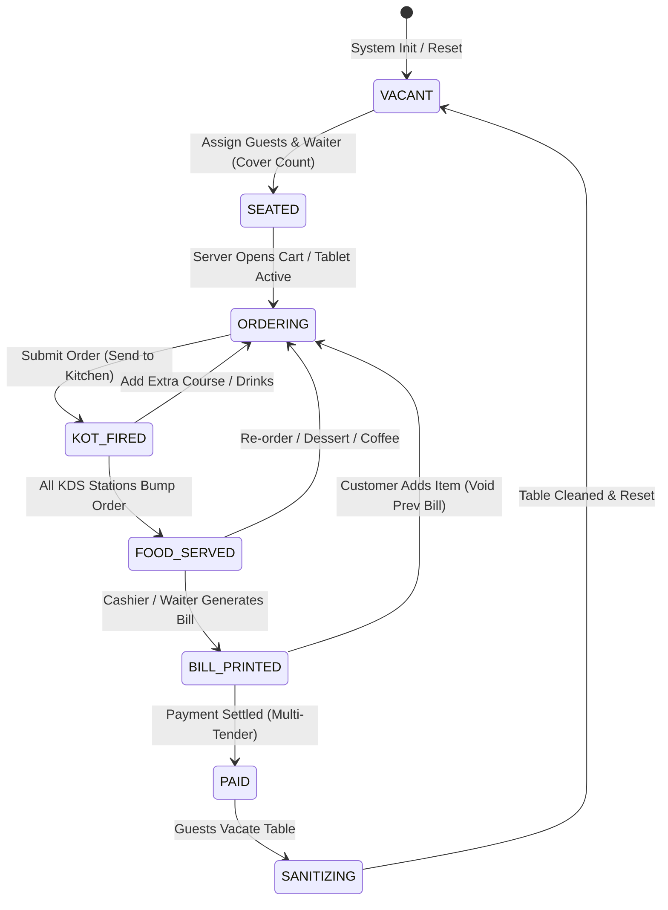
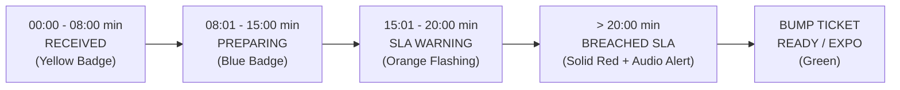
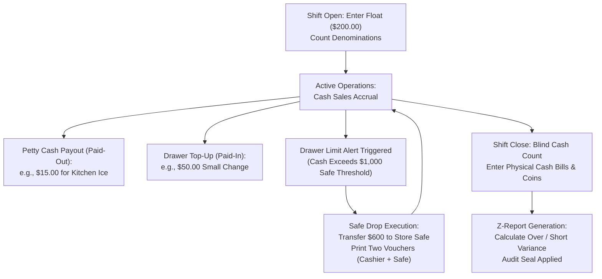

# POS Table Management, KOT & Cash Counter Architecture
## Production Engineering & UX Technical Specification

**Document Version:** 1.0.0  
**Target Systems:** Point of Sale (POS) Terminal, Mobile Waiter POS (mPOS), Kitchen Display System (KDS), Cash Counter & Drawer Register  
**Authors:** Architecture Team (`agency-frontend-developer` & `agency-ux-architect`)  
**Status:** Approved for Implementation  

---

## Table of Contents
1. [System Topology & Hybrid Edge Architecture](#1-system-topology--hybrid-edge-architecture)
2. [Dine-In Table Management & Floor Layout Engine](#2-dine-in-table-management--floor-layout-engine)
   - [2.1 Floor Zones & Table Hierarchy](#21-floor-zones--table-hierarchy)
   - [2.2 Table Finite State Machine (FSM)](#22-table-finite-state-machine-fsm)
   - [2.3 Operational Workflows: Split, Merge, Transfer, Waiter Assignment & Covers](#23-operational-workflows-split-merge-transfer-waiter-assignment--covers)
   - [2.4 Offline-First Resilience & Sync Engine](#24-offline-first-resilience--sync-engine)
3. [High-Speed Table Ordering & KOT Dispatch Engine](#3-high-speed-table-ordering--kot-dispatch-engine)
   - [3.1 High-Speed Ergonomic Item Selection](#31-high-speed-ergonomic-item-selection)
   - [3.2 Seat-Wise Ordering & Multi-Course Sequencing](#32-seat-wise-ordering--multi-course-sequencing)
   - [3.3 Modifiers, Customizations & Allergen Safety Guardrails](#33-modifiers-customizations--allergen-safety-guardrails)
   - [3.4 KOT Multi-Station Routing & Transport Layer](#34-kot-multi-station-routing--transport-layer)
   - [3.5 Kitchen Display System (KDS) & SLA Timing](#35-kitchen-display-system-kds--sla-timing)
   - [3.6 Anti-Theft Void KOT & Item Cancellation Protocol](#36-anti-theft-void-kot--item-cancellation-protocol)
4. [Cash Counter & POS Billing Engine](#4-cash-counter--pos-billing-engine)
   - [4.1 Deterministic Bill Calculation Engine & Tax Split](#41-deterministic-bill-calculation-engine--tax-split)
   - [4.2 Multi-Tender & Split-Billing Workflows](#42-multi-tender--split-billing-workflows)
   - [4.3 Cash Drawer Lifecycle: Float, Paid-In, Paid-Out & Safe Drops](#43-cash-drawer-lifecycle-float-paid-in-paid-out--safe-drops)
   - [4.4 Blind Cash Count & End-of-Day Z-Report](#44-blind-cash-count--end-of-day-z-report)
   - [4.5 Anti-Fraud Controls, Overrides & Forensic Audit Trails](#45-anti-fraud-controls-overrides--forensic-audit-trails)
5. [Hardware Integration & Peripheral Protocols](#5-hardware-integration--peripheral-protocols)
   - [5.1 ESC/POS Thermal Printing & Kick-Pulse Generation](#51-escpos-thermal-printing--kick-pulse-generation)
   - [5.2 Barcode Scanners, Customer Displays & Card Terminals](#52-barcode-scanners-customer-displays--card-terminals)
6. [UI/UX Wireframes & Component Specifications](#6-uiux-wireframes--component-specifications)
   - [6.1 Interactive Floor Plan & Table Management Screen](#61-interactive-floor-plan--table-management-screen)
   - [6.2 High-Speed Order Entry & Cart Screen](#62-high-speed-order-entry--cart-screen)
   - [6.3 Cash Counter Checkout & Tender Modal](#63-cash-counter-checkout--tender-modal)
   - [6.4 Kitchen Display System (KDS) Station & Expo Screen](#64-kitchen-display-system-kds-station--expo-screen)
   - [6.5 Ergonomic Keyboard Shortcut Reference](#65-ergonomic-keyboard-shortcut-reference)
7. [TypeScript Domain Contracts & Schemas](#7-typescript-domain-contracts--schemas)

---

## 1. System Topology & Hybrid Edge Architecture

A premier multi-zone dining establishment requires sub-50ms user interface responsiveness and **zero tolerance for operational downtime**. Internet outages, router reboots, or cloud provider latencies must never prevent servers from taking orders, kitchen printers from firing tickets, or the cash counter from collecting payment and popping the cash drawer.

```
+-----------------------------------------------------------------------------------+
|                              CLOUD BACKOFFICE (WAN)                               |
|        Analytics, Multi-Unit Sync, Central Menu, Accounting Integration           |
+-----------------------------------------------------------------------------------+
                                          ^
                                          | HTTPS / WSS / gRPC Sync (Async Outbox)
                                          v
+-----------------------------------------------------------------------------------+
|                        LOCAL IN-STORE EDGE GATEWAY (LAN)                         |
|   Local SQLite/PostgreSQL Database, Node.js / Rust Core, Local MQTT & WebSocket   |
+-----------------------------------------------------------------------------------+
      |                            |                                |
      | LAN / Wi-Fi                | LAN / Wi-Fi                    | Dual Eth / Wi-Fi
      v                            v                                v
+--------------------+   +--------------------+           +--------------------+
|  WAITER TABLETS    |   |  KITCHEN SCREENS   |           | CASH COUNTER POS   |
|  (mPOS Devices)    |   |  (KDS Displays)    |           | Terminal & Drawer  |
| - Local IndexedDB  |   | - MQTT Subscriber  |           | - Local SQLite/IDB |
| - Offline Queues   |   | - Audio Chimes     |           | - ESC/POS Drivers  |
| - Touch-Grid UI    |   | - Bump Bars (USB)  |           | - Serial/USB Kick  |
+--------------------+   +--------------------+           +--------------------+
                                                                    |
                                           +------------------------+------------------------+
                                           |                        |                        |
                                           v                        v                        v
                                  +------------------+     +------------------+     +------------------+
                                  | 80mm Thermal     |     | RJ12 Solenoid    |     | Dual-Facing      |
                                  | Receipt Printer  |     | Cash Drawer      |     | Customer Display |
                                  | (ESC/POS Raw)    |     | (24V Kick Pulse) |     | (Line Display)   |
                                  +------------------+     +------------------+     +------------------+
```

### Core Architecture Principles:
1. **Local-First Data Authority:** All order creation, bill calculation, and KOT generation are committed to the local in-store edge database first.
2. **Deterministic Fallback:** If the Local Edge Gateway experiences hardware failure, POS terminals automatically fall back to peer-to-peer ad-hoc discovery (mDNS/Bonjour) and local storage (IndexedDB / SQLite embedded).
3. **Hardware Redundancy:** Thermal receipt printers connect via Ethernet/USB with auto-switchover to Bluetooth or serial interfaces upon packet timeouts.

---

## 2. Dine-In Table Management & Floor Layout Engine

### 2.1 Floor Zones & Table Hierarchy

The floor management engine represents the physical restaurant as a hierarchically partitioned 2D spatial canvas. Floors are grouped into distinct semantic zones, each governed by specific service policies, tax profiles, and staff assignments:

1. **Main Dining Room (MDR):** High-density tables, multi-cover configurations, primary waiter stations.
2. **Patio / Al Fresco (PAT):** Weather-dependent seating, dynamic service charges, mobile handheld ordering.
3. **Bar & Lounge (BAR):** Seat-level tabs, immediate card authorization, high turnover, quick-pour drink sequencing.
4. **Banquet / Private Dining (PDR):** Fixed minimum spend rules, pre-set course schedules, multi-table grouping.
5. **Rooftop (RTF):** Premium lounge seating, bottle service workflows, high wind printer-less digital KDS routing.

#### Table Spatial Attributes:
- **Geometry:** `Round` (diameter), `Rectangular` (width x height), `Booth` (fixed perimeter orientation).
- **Positioning:** Normalized 2D coordinate matrix `(x, y)` supporting snap-to-grid (8px increments) and freeform rotation `(0° to 360°)`.
- **Capacity Definition:** Minimum capacity, standard cover capacity, and maximum overflow capacity (e.g., standard 4-top expandable to 6).

---

### 2.2 Table Finite State Machine (FSM)

A dine-in table transitions through an eight-state lifecycle. State transitions trigger automated side effects (e.g., locking carts, firing tickets, notifying floor managers).



#### Detailed State Specifications & Invariants

| State | Color Token | Description | Allowed Actions | Invariant Rules |
| :--- | :--- | :--- | :--- | :--- |
| `VACANT` | `Emerald-500` (#10B981) | Clean, empty table ready for seating. | Seat Party, Reserve, Link Table. | Active Bill ID must be `NULL`. Cover count = 0. |
| `SEATED` | `Sky-500` (#0EA5E9) | Guests present, assigned to waiter, reviewing menu. | Open Cart, Change Waiter, Update Covers. | Cover count must be $\ge 1$. Waiter ID required. |
| `ORDERING` | `Amber-500` (#F59E0B) | Waiter or guest tablet modifying draft cart. | Add Items, Apply Modifiers, Fire KOT. | Temporary cart lock on table to prevent concurrent overrides. |
| `KOT_FIRED` | `Orange-600` (#EA580C) | Active items being prepared in kitchen/bar. | Fire additional KOT, View KDS status. | Table cannot be set to `VACANT` without Supervisor Void. |
| `FOOD_SERVED` | `Indigo-500` (#6366F1) | All kitchen items bumped as ready & served. | Add Course, Generate Provisional Bill. | Timer tracks dwell time post-service for floor turnover. |
| `BILL_PRINTED` | `Violet-600` (#7C3AED) | Provisional bill printed and handed to table. | Settle Payment, Void Bill for Additions. | Order items locked against modification without Manager PIN. |
| `PAID` | `Teal-500` (#14B8A6) | Total bill settled; receipt issued to customer. | Clear Table, Release to Sanitizing. | Balance must be exactly 0.00. Table lock releases. |
| `SANITIZING` | `Rose-400` (#FB7185) | Guests departed; busser cleaning & resetting. | Mark Clean & Available. | Cannot seat new party until marked clean. |

---

### 2.3 Operational Workflows: Split, Merge, Transfer, Waiter Assignment & Covers

#### A. Split Table (Party & Order Splitting)
1. **Physical Split:** Table `T-12` (8 covers) splits into `T-12A` (4 covers) and `T-12B` (4 covers).
2. **Item-Level Bill Split:**
   - Cashier selects Table -> "Split Table Orders".
   - Items in the active order are visually dragged into Target Sub-Accounts (Sub-Bill 1, Sub-Bill 2, etc.).
   - Shared appetizers (e.g., Nachos $18.00) can be fractionalized: `Split equally across N sub-bills` ($9.00 each) or assigned to a specific seat.
   - Separate bill numbers and QR codes generate for each sub-account.

#### B. Merge / Join Tables
- **Scenario:** Two distinct physical tables (`T-04` and `T-05`) join for a party of 10.
- **Rules Engine:**
  - One table is designated as **Primary** (`T-04`), the second as **Child** (`T-05`).
  - Child table inherits Primary table's active bill, waiter assignment, and guest covers.
  - On the floor map, a visual bridge link renders between `T-04` and `T-05`.
  - Child table cannot be billed independently.
  - Releasing or settling `T-04` automatically transitions `T-05` to `SANITIZING`.

#### C. Change / Shift Table (Table Transfer)
- **Scenario:** Party moves from Bar (`B-02`) to Main Dining (`T-14`).
- **Transfer Procedure:**
  1. System checks Target Table status (Must be `VACANT`).
  2. Transactional state swap: All active KOTs, fired items, pending courses, and draft bills transfer to `T-14`.
  3. Edge Gateway broadcasts an instant notification to KDS screens:  
     `NOTICE: Order #1042 relocated from Bar B-02 to Table T-14`.
  4. Origin table resets to `SANITIZING` or `VACANT`.
  5. Audit log records: `Timestamp`, `Shifted By (Employee ID)`, `From Table`, `To Table`, `Reason`.

#### D. Waiter Assignment & Cover Tracking
- **Cover Rules:** Each seating event demands a non-zero cover count. Cover analytics drive:
  - Average Spend Per Head (ASPH): $\text{Gross Sales} / \text{Covers}$.
  - Minimum Spend Alerts (e.g., Banquets requiring minimum spend of $50/cover).
  - Fire safety headcount monitoring across building zones.
- **Server Load Balancing:** Waiter assignment modal displays real-time load: active tables per server, open covers, and active order age to avoid over-allocating servers.

---

### 2.4 Offline-First Resilience & Sync Engine

Waiters operating handheld tablets on the perimeter or patio must never face frozen screens when Wi-Fi drops.

```
+-----------------------------------------------------------------------------------+
|                            MPOS TABLET CLIENT ENGINE                              |
|                                                                                   |
|  +--------------------+    Writes     +----------------------------------------+  |
|  | User Interface /   | ------------> | Local IndexedDB Storage (Dexie.js)     |  |
|  | Cart React State   |               | - Tables, Active Orders, Menu Cache    |  |
|  +--------------------+               +----------------------------------------+  |
|                                                           |                       |
|                                               Enqueues    v                       |
|                                       +----------------------------------------+  |
|                                       | Local Outbox Queue (`outbox_events`)   |  |
|                                       | { eventId, type, payload, vectorClock} |  |
|                                       +----------------------------------------+  |
+-----------------------------------------------------------|-----------------------+
                                                            |
                                        Auto-Reconnect Ping v (LAN WebSockets / HTTP)
+-----------------------------------------------------------------------------------+
|                        LOCAL IN-STORE EDGE GATEWAY                                |
|                                                                                   |
|  +-----------------------------------------------------------------------------+  |
|  | Sync Ingestion Worker & Conflict Resolution Engine                          |  |
|  | - Append-only Event Journal                                                 |  |
|  | - Vector Clock Evaluation & LWW (Last-Write-Wins)                           |  |
|  | - Atomic Table Transaction Coordinator                                      |  |
|  +-----------------------------------------------------------------------------+  |
|                                           |                                       |
|                                           v                                       |
|  +-----------------------------------------------------------------------------+  |
|  | Local SQLite / PostgreSQL Master Database                                   |  |
|  +-----------------------------------------------------------------------------+  |
+-----------------------------------------------------------------------------------+
```

#### Sync & Conflict Resolution Rules:
1. **Append-Only Cart Items:** Item additions are strictly additive. If Tablet A adds "Garlic Bread" offline and Tablet B adds "Pasta" offline, the Sync Engine applies union logic: the merged bill contains both.
2. **State Locking Conflicts:** If Server A marks Table 5 as `SEATED` while Server B marks Table 5 as `RESERVED` during a split-second network partition:
   - Lowest Lamport timestamp wins for metadata.
   - If an order has been fired (`KOT_FIRED`), it takes permanent precedence over reservations.
3. **Local Bill Printing:** If WAN drops entirely, the POS cash counter prints provisional bills and final receipts directly across the LAN using raw IP-socket ESC/POS connections (`tcp://192.168.1.200:9100`).

---

## 3. High-Speed Table Ordering & KOT Dispatch Engine

### 3.1 High-Speed Ergonomic Item Selection

In rush-hour environments (12:30 PM lunch or 8:30 PM dinner rush), cashiers and servers must add an item within **under 1.5 seconds**.

```
+------------------------------------------------------------------------------------------------------+
| [Search Food Items / PLU... (Ctrl+K)] | [STARTERS] [MAINS] [BREADS] [CURRIES] [BAR] [DESSERTS] [FAVS]|
+------------------------------------------------------------------------------------------------------+
| [101 Butter Chicken]  | [102 Paneer Tikka]   | [103 Dal Makhani]    | [104 Garlic Naan]              |
| $18.50  | Non-Veg     | $14.00  | Veg        | $13.00  | Veg        | $4.00   | Veg                  |
| Hotkey: [B]           | Hotkey: [P]          | Hotkey: [D]          | Hotkey: [G]                    |
+-----------------------+----------------------+----------------------+--------------------------------+
| [105 Tandoori Roti]   | [106 Biryani (Dum)]  | [107 Lamb Rogan Josh]| [108 Gulab Jamun]              |
| $3.50   | Veg         | $19.00  | Halal      | $21.00  | Halal      | $6.00   | Veg                  |
+------------------------------------------------------------------------------------------------------+
```

#### Ergonomic Design Standards:
- **Target Touch Dimensions:** Minimum touch target size of 84px x 84px for grid buttons with 8px margins.
- **Search Latency Target:** `< 12ms` using an in-memory prefix trie caching item names, shortcuts, PLU codes, and alternate spellings (e.g., typing "bc" immediately highlights "Butter Chicken").
- **Dynamic Quick-Row:** Displays the 6 most frequently ordered items for the current operational shift (computed dynamically from the previous 30 days of shift data).

---

### 3.2 Seat-Wise Ordering & Multi-Course Sequencing

High-end dining and busy bistros require accurate seat tracking to avoid server "auctioning of food" ("Who ordered the Salmon?") and precise culinary pacing.

#### A. Seat Allocation
- Every line item attaches to an integer `seat_number` (`0` = Table Center / Shared; `1` to `N` = Individual Guest Seats).
- Handheld tablet renders seat circles corresponding to physical chair positions relative to the service entry point.

#### B. Course Pacing Pipeline
Courses follow an indexed sequencing pipeline:

```
[Course 1: BEVERAGES] ---> [Course 2: STARTERS] ---> [Course 3: MAINS] ---> [Course 4: DESSERTS]
      (Immediate)                (Auto/Hold)              (Hold & Fire)              (Hold)
```

1. **Fire Now:** Ticket prints/appears on KDS immediately.
2. **Hold:** Kitchen receives item in "HELD" state (greyed out, does not trigger prep timer).
3. **Fire Course Button:** Single tap on "Fire Mains" releases all Course 3 items across all respective kitchen stations simultaneously.
4. **Paced Delay Timer:** Optional automated trigger: "Fire Course 3 exactly 18 minutes after Course 2 is bumped from Expo".

---

### 3.3 Modifiers, Customizations & Allergen Safety Guardrails

#### Modifier Hierarchy:
1. **Mandatory Modifiers (Choose 1):**  
   *Example:* Steak Doneness -> `[Rare] [Medium Rare] [Medium] [Well Done]`
2. **Optional Modifiers (Multi-select with pricing delta):**  
   *Example:* Burger Upgrades -> `[+ Extra Cheddar $1.50] [+ Bacon $2.50] [Gluten-Free Bun $2.00]`
3. **Rapid Prep Note Tokens:**  
   Single-tap chips appending standardized instructions to ticket:
   `[No Onion/Garlic]` `[Extra Spicy]` `[Mild]` `[Sauce on Side]` `[Less Salt]` `[Crispy]`

#### Critical Allergen Guardrail System:
- When an allergy toggle is checked (e.g., **PEANUT**, **CELIAC / GLUTEN**, **SHELLFISH**, **DAIRY**):
  1. The item row on the POS highlights in high-contrast solid red (`#DC2626`) with an icon warning.
  2. The server must acknowledge a safety prompt before cart submission.
  3. The physical KOT thermal ticket prints the allergy block using **Double-Width, Double-Height Inverted White-on-Black text**:
     ```
     *** ALLERGY WARNING: SEVERE PEANUT ALLERGY ***
     GUEST AT SEAT #2 CANNOT CONSUME PEANUTS OR CROSS-CONTAMINANTS
     ```
  4. The digital KDS screen locks the ticket header in flashing red until kitchen staff taps to acknowledge.

---

### 3.4 KOT Multi-Station Routing & Transport Layer

When a server taps "Fire KOT", the Order Dispatch Engine evaluates line items against the Kitchen Routing Matrix. A single order can instantly split across multiple distinct kitchen printers and KDS screens.

#### Multi-Station Routing Matrix

| Station Code | Station Name | Equipment Type | IP / Port | Matching Item Categories |
| :--- | :--- | :--- | :--- | :--- |
| `KDS-01` | **Tandoor & Grill** | 21" Touch KDS Display | `mqtt://edge.local:1883/kds/tandoor` | Tikkas, Kebabs, Rotis, Naans, Grilled Seafood |
| `KDS-02` | **Wok & Asian** | 21" Touch KDS Display | `mqtt://edge.local:1883/kds/wok` | Noodles, Dim Sum, Fried Rice, Stir Fry |
| `PRN-03` | **Continental / Mains** | 80mm Impact Kitchen Printer | `tcp://192.168.1.182:9100` | Pastas, Steaks, Burgers, Pizzas |
| `PRN-04` | **Service Bar** | 80mm Thermal Receipt Printer| `tcp://192.168.1.183:9100` | Cocktails, Draught Beer, Wines, Soft Drinks |
| `KDS-05` | **Expediter (Expo)** | 27" Master Expo Display | `mqtt://edge.local:1883/kds/expo` | **ALL STATIONS** (Unified Ticket View) |

#### Physical KOT ESC/POS Layout Standard (80mm Width)

```
================================================
           *** KITCHEN ORDER TICKET ***         
Station: TANDOOR & GRILL          Type: DINE-IN 
Table: T-12                       KOT #: 0048   
Server: Maria R.                  Date: 26-OCT-26
Guests: 4                         Time: 19:42:10
================================================
COURSE: STARTERS
------------------------------------------------
QTY  ITEM                         SEAT  PREP
[2]  PANEER TIKKA                  S-1  Spicy
     >> Note: Extra Mint Chutney
[1]  MURGH MALAI TIKKA             S-3  Standard
------------------------------------------------
COURSE: MAINS (HOLD UNTIL FIRED)
------------------------------------------------
[1]  TANDOORI ROTI (BUTTER)        S-0  Crisp
[2]  GARLIC NAAN                   S-0  Standard
================================================
*** ALLERGY ALERT: SEAT 1 - MUSHROOM ALLERGY ***
================================================
```

---

### 3.5 Kitchen Display System (KDS) & SLA Timing

The KDS replaces messy paper slips with an intelligent real-time workflow manager.

```
+----------------------------------------------------------------------------------------+
| KDS: WOK & ASIAN STATION                      | Active: 6 | Overdue: 1 | Shift Avg: 9m |
+----------------------------------------------------------------------------------------+
| TICKET #0042        12m | TICKET #0043         6m | TICKET #0045         1m            |
| Table: T-04    Server: Raj| Table: T-08   Server: Amy| Table: B-02     Server: Maria   |
| [SLA WARNING: 12 MINS]  | [SLA NORMAL: 6 MINS]     | [NEW TICKET: 1 MIN]             |
| [STATUS: PREPARING]     | [STATUS: RECEIVED]       | [STATUS: RECEIVED]              |
|-------------------------|--------------------------|---------------------------------|
| [X] 2x Hakka Noodles    | [ ] 1x Thai Green Curry  | [ ] 1x Spring Rolls             |
|     - Less Oil          |     - Veg                |     - Sweet Chili Dip           |
| [ ] 1x Kung Pao Chicken | [ ] 2x Jasmine Rice      | [ ] 1x Chicken Satay            |
|     - Extra Peanuts (!!) |                          |                                 |
|-------------------------|--------------------------|---------------------------------|
| [BUMP ITEM] [BUMP ORDER]| [START PREP] [BUMP]      | [START PREP] [BUMP]             |
+----------------------------------------------------------------------------------------+
```

#### SLA Timer Thresholds & Audio Signals:



- **Audio Cue Frequencies (Web Audio API Synthesizer):**
  - *New Ticket Arrival:* Dual-chime harmonic `587.33 Hz (D5)` -> `880.00 Hz (A5)` (200ms burst).
  - *SLA Warning Chime:* Urgent low pulse `220.00 Hz (A3)` recurring every 45s until acknowledged.
  - *Item Void Siren:* High descending triad `1046.50 Hz` -> `783.99 Hz` -> `523.25 Hz`.

---

### 3.6 Anti-Theft Void KOT & Item Cancellation Protocol

Kitchen theft and unaccounted food waste frequently occur when staff prepare food, cancel the item on the POS, and pocket the cash or give food to friends.

#### The Zero-Leakage Cancellation Protocol:
1. **Locking Rule:** Once a KOT is fired to the kitchen, **no line item can be modified, decreased in quantity, or deleted** without a **Manager Override PIN** (4 to 6 digits) or Manager RFID swipe.
2. **Cancellation Reason Taxonomy:**
   The cashier/waiter must select an authorized reason code:
   - `CANC-01`: Guest Changed Mind (Before Preparation Started).
   - `CANC-02`: Food Quality Reject / Return from Table (Plate Wasted).
   - `CANC-03`: Kitchen Stock Out / Ingredient Depleted.
   - `CANC-04`: Accidental Server Duplicate Entry.
   - `CANC-05`: Service Delay / Guest Walkout.
3. **Kitchen Notification:**
   - Immediately prints an **Item Void Ticket** on the target kitchen printer in red ink / bold or flashes a strike-through on the KDS screen with a loud audible alert.
   - Prevents the chef from cooking an unwanted dish or alerts the chef to reclaim an already plated dish.
4. **Waste Ledger Integration:** If preparation had already commenced (`PREPARING` or `READY`), inventory components are deducted to the `WASTE_LEDGER` with the cost attributed to restaurant shrinkage.

---

## 4. Cash Counter & POS Billing Engine

### 4.1 Deterministic Bill Calculation Engine & Tax Split

Financial calculations must be mathematically provable with **zero floating-point rounding drift**. All internal mathematical operations use integer minor units (cents / paise) or arbitrary-precision decimal libraries (`Decimal.js`).

#### Sequential Order of Calculation:

$$\text{Item Gross} = \sum (\text{Unit Price} \times \text{Qty}) + \sum \text{Modifier Prices}$$

$$\text{Line Discount} = \text{CalculateLineDiscounts}(\text{Item Gross})$$

$$\text{Net Item Subtotal} = \text{Item Gross} - \text{Line Discount}$$

$$\text{Bill Subtotal} = \sum \text{Net Item Subtotal}$$

$$\text{Cart Discount} = \text{Flat Discount} + \left( \text{Bill Subtotal} \times \frac{\text{Percent Discount}}{100} \right)$$

$$\text{Taxable Subtotal} = \text{Bill Subtotal} - \text{Cart Discount}$$

$$\text{Service Charge} = \text{Taxable Subtotal} \times \frac{\text{Service Charge Rate}\%}{100}$$

$$\text{Tax Base} = \text{Taxable Subtotal} + \text{Service Charge (if taxable by jurisdiction)}$$

$$\text{CGST} = \text{Tax Base} \times \frac{2.5\%}{100}, \quad \text{SGST} = \text{Tax Base} \times \frac{2.5\%}{100} \quad (\text{Total GST: } 5.0\%)$$

$$\text{VAT (Liquor Items Only)} = \text{Taxable Liquor Subtotal} \times \frac{20\%}{100}$$

$$\text{Grand Total (Exact)} = \text{Tax Base} + \text{CGST} + \text{SGST} + \text{VAT}$$

$$\text{Net Payable} = \text{RoundToNearestCashUnit}(\text{Grand Total})$$

#### Rounding Rule Standard:
- **Cash Payments:** Half-Up rounding to nearest whole integer currency unit ($1.00 or ₹1.00) or 0.50 unit based on statutory local guidelines.
- **Card / UPI Payments:** Exact 2-decimal place settlement (e.g., $104.78 stays $104.78).
- Rounding differential is stored in a dedicated ledger field `rounding_adjustment` (e.g., `-$0.28`).

---

### 4.2 Multi-Tender & Split-Billing Workflows

Customers in dining groups demand flexible settlement options. The billing engine supports simultaneous mixed tenders:

```
+-------------------------------------------------------------------------------+
| SETTLE BILL: TABLE T-12                            | TOTAL DUE: $125.00       |
+-------------------------------------------------------------------------------+
| Remaining Balance: $0.00                           | Settled: $125.00         |
+-------------------------------------------------------------------------------+
| TENDER APPLIED:                                                               |
|  [Tender 1] Card (Visa ending in 4102)            : $60.00   [Auth: 894120]   |
|  [Tender 2] UPI / Dynamic QR                      : $40.00   [Txn: 9942185]   |
|  [Tender 3] Cash (Tendered: $30.00 | Change: $5.00): $25.00                   |
+-------------------------------------------------------------------------------+
| [F1 Cash] [F2 Card Integrated] [F3 UPI QR] [F4 Dining Voucher] [F5 House Tab] |
| [ENTER: FINALIZE & PRINT RECEIPT]                           [ESC: CANCEL]     |
+-------------------------------------------------------------------------------+
```

#### Split Bill Modalities:
1. **Equal Division (N Ways):**
   Total payable ($100.00) split 3 ways: Person 1 = $33.34, Person 2 = $33.33, Person 3 = $33.33. The system automatically assigns the 1-cent residual to the first sub-tender.
2. **Split by Seat:**
   Seats 1 & 2 pay for their specific burgers and sodas ($42.50) on Card; Seats 3 & 4 pay for their steaks and wine ($82.50) via UPI.
3. **Custom Amount Split:**
   Customer says: "Put $50 on my company card, and we'll pay the rest in cash."
4. **House Tab / Customer Credit Account:**
   Charges billed against an approved corporate or regular patron account with credit limits and monthly invoice generation.

---

### 4.3 Cash Drawer Lifecycle: Float, Paid-In, Paid-Out & Safe Drops

Cash drawer reconciliation requires strict lifecycle controls across each working shift.



#### Shift Procedures:
- **Shift Opening (Float In):** Cashier opens register and inputs bill count (e.g., 20 x $5, 10 x $10). Float is locked in memory.
- **Paid-In:** Cash added to drawer from office safe for change replenishment.
- **Paid-Out (Petty Cash Voucher):** Emergency minor operational purchase (e.g., dairy top-up, emergency cleaning supplies). Demands: Amount, Category, Vendor Name, Receipt Photo / Attachment, Cashier Signature.
- **Safe Skim / Safe Drop:** High cash build-up presents robbery risk. When drawer cash exceeds configured maximum (e.g., $1,000), system displays a mandatory prompt: "Safe Drop Required". Cashier removes cash, registers safe drop of $600, drawer balance decreases, dual receipts print.

---

### 4.4 Blind Cash Count & End-of-Day Z-Report

#### The Blind Count Principle:
To eliminate cashier falsification, **the system NEVER shows the cashier how much cash is expected in the drawer during end-of-shift reconciliation**.
1. Cashier taps "Close Shift".
2. System presents an empty denomination matrix.
3. Cashier counts physical paper and metal in the drawer and enters quantities:
   ```
   100 x $20  = $2,000.00
    50 x $10  =   $500.00
    30 x  $5  =   $150.00
    40 x  $1  =    $40.00
   Coins      =    $12.50
   -----------------------
   TOTAL COUNTED: $2,702.50
   ```
4. Cashier presses "Submit Final Count". Count is sealed.
5. System evaluates variance against the transactional formula:

$$\text{Expected Cash} = \text{Opening Float} + \text{Total Cash Sales} + \text{Paid-In} - \text{Paid-Out} - \text{Safe Drops}$$

$$\text{Variance} = \text{Actual Counted Cash} - \text{Expected Cash}$$

$$\text{Classification} = \begin{cases} \text{EXACT}, & \text{if Variance} = 0 \\ \text{OVER}, & \text{if Variance} > 0 \\ \text{SHORT}, & \text{if Variance} < 0 \end{cases}$$

6. **Z-Report (End of Day Master Audit Slip):**
   Prints an unalterable summary on the thermal receipt printer and sends an encrypted summary PDF to the General Manager's email.

---

### 4.5 Anti-Fraud Controls, Overrides & Forensic Audit Trails

#### Fraud Vector Mitigations

| Fraud Vector | Attack Mechanism | Enforced System Counter-Measure |
| :--- | :--- | :--- |
| **Pocketing Cash on Void** | Cashier collects cash from table, voids the bill, and keeps the bills. | Bill printing locks order. Voiding a printed bill requires Manager PIN, records reason, and alerts CCTV timestamp. |
| **Phantom Drawer Kick** | Cashier pops drawer using paperclip or manual button to steal cash. | Hardware micro-switch in cash drawer detects any physical opening. If drawer opens without an active sale, a high-priority `SECURITY_ALERT: UNRECORDED_DRAWER_KICK` event logs. |
| **Sweethearting Discounts** | Cashier gives excessive 50% discounts to acquaintances. | Max cashier discount capped at 10%. Any discount $> 10\%$ triggers mandatory Supervisor Authorization dialog. |
| **Re-use of Receipts** | Cashier prints duplicate receipt to hand to a cash customer. | Duplicate receipts have a massive watermark `*** DUPLICATE REPRINT ***` with a counter `Reprint #2`. All reprints logged to audit trail. |

---

## 5. Hardware Integration & Peripheral Protocols

### 5.1 ESC/POS Thermal Printing & Kick-Pulse Generation

The POS software communicates directly with 80mm ESC/POS compliant receipt printers (Epson TM-T88VI, Star TSP100, Bixolon SRP-350) using raw TCP sockets, WebUSB, or RS-232 serial.

#### Cash Drawer Kick Command Specification:
The cash drawer is connected to the receipt printer via a standard 6-pin RJ12 modular connector carrying a 24V solenoid pulse.

```
ESC p m t1 t2
Hexadecimal: 1B 70 m t1 t2
ASCII:       [ESC] p m t1 t2
```

- `m`: Connector pin designation (`0x00` for Pin 2; `0x01` for Pin 5).
- `t1`: Pulse ON time ($t1 \times 2\text{ms}$). Set to `0x19` ($25 \times 2\text{ms} = 50\text{ms}$).
- `t2`: Pulse OFF time ($t2 \times 2\text{ms}$). Set to `0xFA` ($250 \times 2\text{ms} = 500\text{ms}$).

#### Production Node.js / Browser ESC/POS Kick Buffer:
```typescript
// Generates standard 24V drawer trigger pulse buffer
export function generateCashDrawerKickPulse(pin: 2 | 5 = 2): Uint8Array {
  const pinByte = pin === 2 ? 0x00 : 0x01;
  const onTime = 0x19;  // 50 milliseconds
  const offTime = 0xfa; // 500 milliseconds
  return new Uint8Array([0x1b, 0x70, pinByte, onTime, offTime]);
}

// Full ESC/POS Print & Cut Pipeline
export function generateCutPaperBuffer(): Uint8Array {
  // GS V 66 0 (Feed paper and partial cut)
  return new Uint8Array([0x1d, 0x56, 0x42, 0x00]);
}
```

---

### 5.2 Barcode Scanners, Customer Displays & Card Terminals

1. **Barcode / 2D QR Scanners (Honeywell, Zebra):**
   - Configured in USB HID Keyboard Emulation mode with carriage return suffix (`\r\n`).
   - Global event listener intercepts keystrokes arriving within $< 30\text{ms}$ intervals as barcode scans rather than manual typing.
2. **Customer-Facing Pole Displays (VFD 2x20 Lines):**
   - Protocol: Raw serial over USB COM port at 9600 baud (8-N-1).
   - Line 1 displays running item: `Butter Chicken     $18.50`
   - Line 2 displays running subtotal: `Total: $42.50`
   - Idle screen displays welcome message and dynamic QR payment link.
3. **Integrated Payment Terminals (EDC / EMV):**
   - Integration via local IP REST/WebSocket (e.g., Stripe Terminal, PineLabs, Verifone).
   - POS sends `PUSH_PAYMENT_REQUEST { amount: 12500, currency: "USD", reference: "BILL-1042" }`.
   - POS enters blocking modal until terminal responds with `PAYMENT_SUCCESS { authCode: "OK7721", cardLast4: "4102" }`.

---

## 6. UI/UX Wireframes & Component Specifications

### 6.1 Interactive Floor Plan & Table Management Screen

```
+--------------------------------------------------------------------------------------------------------------------------+
|  REST-O-MASTER POS v3.4 | SHIFT #104 - REGISTER 01 | USER: Captain Arjun [Mgr]                  | 26-OCT-2026 19:45:12    |
+--------------------------------------------------------------------------------------------------------------------------+
| ZONES: [1. MAIN DINING (14/18)]  [2. PATIO (6/8)]  [3. BAR (9/12)]  [4. BANQUET (2/2)]  [5. ROOFTOP (8/10)]              |
+--------------------------------------------------------------------------------------------------------------------------+
|  FLOOR MAP: MAIN DINING ROOM                                                    | SELECTED TABLE: T-04                   |
|                                                                                 |----------------------------------------|
|   +---------------+     +---------------+     +---------------+                 | Status: KOT FIRED (In Kitchen)         |
|   | T-01   [4/4]  |     | T-02   [2/2]  |     | T-03   [6/6]  |                 | Waiter: Raj S.                         |
|   | SEATED        |     | VACANT        |     | BILL PRINTED  |                 | Guests: 4 Covers                       |
|   | Time: 12 min  |     | Ready         |     | Dwell: 54 min |                 | Dwell Time: 28 mins                    |
|   +---------------+     +---------------+     +---------------+                 | Current Total: $88.50                  |
|                                                                                 | Active KOTs: #0041, #0045              |
|   +---------------+     +---------------+     +---------------+                 |----------------------------------------|
|   | T-04 * [4/4]  |     | T-05   [4/4]  |     | T-06   [8/8]  |                 | TABLE ACTIONS:                         |
|   | KOT FIRED     |     | FOOD SERVED   |     | SANITIZING    |                 | [F1] Open Order / Add Items            |
|   | Time: 28 min  |     | Time: 35 min  |     | Reset Soon    |                 | [F2] Print Provisional Bill            |
|   +---------------+     +---------------+     +---------------+                 | [F3] Transfer / Shift Table            |
|                                                                                 | [F4] Merge with Another Table          |
|   +---------------+     +---------------+     +---------------+                 | [F5] Split Table / Bill                |
|   | T-07   [2/2]  |     | T-08   [2/2]  |     | T-09   [4/4]  |                 | [F6] Change Server / Covers            |
|   | ORDERING      |     | PAID          |     | VACANT        |                 |                                        |
|   | Time: 5 min   |     | Clear Soon    |     | Ready         |                 | [ESC] Back to Dashboard                |
+--------------------------------------------------------------------------------------------------------------------------+
| LEGEND: [Green: Vacant]  [Blue: Seated]  [Orange: KOT Active]  [Indigo: Served]  [Purple: Billed]  [Red: Sanitizing]     |
+--------------------------------------------------------------------------------------------------------------------------+
```

---

### 6.2 High-Speed Order Entry & Cart Screen

```
+--------------------------------------------------------------------------------------------------------------------------+
| TABLE: T-04 | COVERS: 4 | WAITER: Raj S. | KOT REF: #0046               | SEARCH: [ chicken                   ] [Clear]  |
+-------------------------------------------------------------------------+------------------------------------------------+
| ACTIVE CART (SEATS & COURSES)                                           | MENU CATEGORIES:                               |
|-------------------------------------------------------------------------| [FAVS] [STARTERS] [TANDOOR] [MAINS] [BEV] [BAR]|
| Seat | Course | Item Name               | Qty | Price   | Status        |------------------------------------------------|
|-------------------------------------------------------------------------| [101 Butter Chicken]   | [102 Tandoori Chicken]|
| S-1  | C-1    | Fresh Lime Soda (Sweet) |  1  | $ 4.50  | [FIRED 19:20] | $18.50 | Non-Veg       | $16.00 | Non-Veg      |
| S-2  | C-1    | Kingfisher Draught 500ml|  1  | $ 7.50  | [FIRED 19:20] |------------------------+-----------------------|
| S-1  | C-2    | Chicken Tikka (Spicy)   |  1  | $15.00  | [SERVED 19:35]| [103 Chicken Biryani]  | [104 Chicken Korma]   |
|      |        | >> Note: Mint Chutney   |     |         |               | $17.50 | Non-Veg       | $18.00 | Non-Veg      |
| S-3  | C-2    | Paneer Malai Tikka      |  1  | $14.00  | [SERVED 19:35]|------------------------+-----------------------|
|-------------------------------------------------------------------------| [105 Kadai Chicken]    | [106 Chicken Chettinad|
| ** NEW UNFIRED ITEMS (DRAFT) **                                         | $18.00 | Non-Veg       | $19.00 | Very Spicy   |
| S-1  | C-3    | Butter Chicken (Mains)  |  1  | $18.50  | [DRAFT]       |------------------------+-----------------------|
| S-0  | C-3    | Garlic Naan (Center)    |  3  | $12.00  | [DRAFT]       | MODIFIER BAR (FOR SELECTED ITEM):              |
| S-2  | C-3    | Dal Makhani             |  1  | $13.50  | [DRAFT]       | [Mild] [Medium] [Extra Spicy] [No Garlic]      |
|      |        | !! ALLERGY: SEAT 2 NO CORIANDER !!      |               | [Extra Gravy +$3] [Gluten-Free]                |
+-------------------------------------------------------------------------+------------------------------------------------+
| Cart Total: $85.00 | Tax (Est): $4.25 | Balance: $89.25                 | ACTIONS:                                       |
| [F7 Hold Course 3]  [F8 Fire Mains Now]  [F9 Quick Discount]           | [F10: FIRE KOT TO KITCHEN]    [F12: SETTLE]   |
+--------------------------------------------------------------------------------------------------------------------------+
```

---

### 6.3 Cash Counter Checkout & Tender Modal

```
+---------------------------------------------------------------------------------------+
|  BILL SETTLEMENT & CHECKOUT - TABLE T-04                                             |
+---------------------------------------------------------------------------------------+
|  Total Items: 8                     Gross Subtotal:                           $112.00 |
|  Discounts Applied:                 VIP Corporate (10%):                      -$11.20 |
|  Service Charge (Taxable):          7.5%:                                       $7.56 |
|  GST Engine:                        CGST (2.5%):                                $2.71 |
|                                     SGST (2.5%):                                $2.71 |
|  Rounding Adjustment:                                                          +$0.22 |
|---------------------------------------------------------------------------------------|
|  NET PAYABLE AMOUNT:                                                          $114.00 |
+---------------------------------------------------------------------------------------+
|  SELECT PAYMENT TENDER:                                                               |
|                                                                                       |
|  [F1] CASH                   Amount: [ $50.00    ]                                    |
|       Tendered: $60.00  |  Change Due: $10.00                                         |
|                                                                                       |
|  [F2] INTEGRATED CARD (EDC)  Amount: [ $64.00    ]  [WAITING FOR CARD INSERTION...]   |
|                                                                                       |
|  [F3] DYNAMIC UPI / QR       Amount: [ $0.00     ]                                    |
|                                                                                       |
|  [F4] SPLIT BILL WAYS        [Split 2 Ways ($57)]  [Split 4 Ways ($28.50)] [By Seat]  |
|                                                                                       |
|---------------------------------------------------------------------------------------|
|  [ENTER] FINALIZE PAYMENT & KICK DRAWER              [ESC] RETURN TO ORDER            |
+---------------------------------------------------------------------------------------+
```

---

### 6.4 Kitchen Display System (KDS) Station & Expo Screen

```
+--------------------------------------------------------------------------------------------------------------------------+
| KDS EXPO SCREEN: ALL ACTIVE ORDERS                                              | TIME: 19:48:02 | SOUND: ON | EXPEDITER |
+--------------------------------------------------------------------------------------------------------------------------+
| TICKET #0044        16:20 | TICKET #0045         8:45 | TICKET #0046         2:10 | TICKET #0047         0:45        |
| Table: T-01    Server: Amy| Table: T-07   Server: Maria| Table: T-04    Server: Raj| Table: B-02     Server: Arjun    |
| [BREACHED SLA - URGENT]   | [SLA WARNING: BLUE]       | [NORMAL - GREEN]          | [NORMAL - GREEN]                 |
|---------------------------|---------------------------|---------------------------|----------------------------------|
| COURSE: MAINS             | COURSE: STARTERS          | COURSE: MAINS             | COURSE: BAR QUICK-POUR           |
|---------------------------|---------------------------|---------------------------|----------------------------------|
| [V] 1x Grilled Sea Bass   | [V] 2x Veg Spring Rolls   | [ ] 1x Butter Chicken     | [ ] 2x Cosmopolitan Cocktails    |
|     (Continental: READY)  |     (Wok: READY)          |     (Tandoor: PREPARING)  | [ ] 1x Gin & Tonic               |
| [ ] 1x Ribeye Steak (Med) | [ ] 1x Crispy Calamari    | [ ] 1x Dal Makhani        |                                  |
|     (Grill: DELAYED)      |     (Fryer: COOKING 4m)   |     (Curry: READY)        |                                  |
| [V] 2x Truffle Fries      |                           | [ ] 3x Garlic Naan        |                                  |
|     (Fryer: READY)        |                           |     (Tandoor: ROLLING)    |                                  |
|---------------------------|---------------------------|---------------------------|----------------------------------|
| BUMP ACTIONS:             | BUMP ACTIONS:             | BUMP ACTIONS:             | BUMP ACTIONS:                    |
| [SPACE] RECALL  [B] BUMP  | [SPACE] RECALL  [B] BUMP  | [SPACE] RECALL  [B] BUMP  | [SPACE] RECALL  [B] BUMP         |
+--------------------------------------------------------------------------------------------------------------------------+
```

---

### 6.5 Ergonomic Keyboard Shortcut Reference

Cash counter operators work with mechanical POS keyboards or high-speed hotkeys to perform all operations without touching a mouse.

| Key Code | Function | Context / Triggered Action |
| :--- | :--- | :--- |
| `F1` | **New Order / Open Table** | Focuses table search or opens empty quick cart. |
| `F2` | **Tender / Settle Bill** | Opens multi-tender checkout modal from any cart. |
| `F3` | **Print Provisional Bill** | Prints table bill to thermal printer without closing order. |
| `F4` | **Manual Drawer Kick** | Fires 24V solenoid pulse (Requires audit reason code). |
| `F5` | **Course Fire (Next)** | Releases next held course to kitchen stations. |
| `F6` | **Switch Zones** | Toggles floor zone tabs (Main Dining -> Patio -> Bar). |
| `F7` | **Item Void / Cancel** | Opens manager-authorized item cancellation modal. |
| `F8` | **Apply Discount** | Opens discount selector (Flat, Percentage, Coupon). |
| `F9` | **Hold Item / Course** | Toggles hold status on selected draft line item. |
| `F10` | **Fire KOT** | Commits draft items and routes tickets to KDS/Printers. |
| `F11` | **Reprint Receipt** | Reprints last transaction receipt with audit counter. |
| `F12` | **Lock Register** | Locks cashier terminal to user PIN screen. |
| `Ctrl + K`| **Omni-Search** | Focuses menu item, guest, or table search bar. |
| `ESC` | **Dismiss / Return** | Cancels modal, steps back one screen level. |
| `Enter` | **Confirm Primary** | Submits current focused action or closes tender. |

---

## 7. TypeScript Domain Contracts & Schemas

The following TypeScript contracts represent the core data structures governing the tables, KOTs, billing, and cash drawer state machines:

```typescript
// ============================================================================
// 1. DINE-IN TABLE & FLOOR TYPES
// ============================================================================

export type FloorZoneId = 'MDR' | 'PATIO' | 'BAR' | 'BANQUET' | 'ROOFTOP';

export type TableStatus =
  | 'VACANT'
  | 'SEATED'
  | 'ORDERING'
  | 'KOT_FIRED'
  | 'FOOD_SERVED'
  | 'BILL_PRINTED'
  | 'PAID'
  | 'SANITIZING';

export interface TableGeometry {
  shape: 'ROUND' | 'RECTANGLE' | 'BOOTH';
  x: number;
  y: number;
  width: number;
  height: number;
  rotation: number;
}

export interface TableEntity {
  id: string;
  tableNumber: string;
  zoneId: FloorZoneId;
  minCovers: number;
  standardCovers: number;
  maxCovers: number;
  geometry: TableGeometry;
  status: TableStatus;
  currentCovers: number;
  assignedWaiterId?: string;
  activeOrderId?: string;
  primaryLinkedTableId?: string; // Set when merged as a child
  mergedChildTableIds?: string[];
  statusChangedAt: string;       // ISO 8601 UTC
}

// ============================================================================
// 2. KOT & ORDER ENGINE TYPES
// ============================================================================

export type CourseType = 'BEVERAGES' | 'STARTERS' | 'MAINS' | 'DESSERTS';

export type KitchenStation = 'TANDOOR' | 'WOK' | 'CONTINENTAL' | 'BAR' | 'PANTRY';

export type KDSItemState = 'RECEIVED' | 'PREPARING' | 'READY' | 'SERVED' | 'CANCELLED';

export interface AllergenProfile {
  hasPeanuts: boolean;
  hasGluten: boolean;
  hasDairy: boolean;
  hasShellfish: boolean;
  hasSoy: boolean;
  customAllergies: string[];
}

export interface OrderModifier {
  id: string;
  name: string;
  priceDelta: number; // In minor units (cents)
  isMandatory: boolean;
}

export interface OrderLineItem {
  lineItemId: string;
  menuItemId: string;
  name: string;
  seatNumber: number; // 0 = Center/Shared, 1..N = Specific Seat
  course: CourseType;
  station: KitchenStation;
  unitPrice: number;  // Minor units: $18.50 -> 1850
  quantity: number;
  modifiers: OrderModifier[];
  prepNotes?: string;
  allergens: AllergenProfile;
  kdsState: KDSItemState;
  kotId?: string;
  firedAt?: string;
  preparedAt?: string;
  isHeld: boolean;
}

export interface KOTDocument {
  kotId: string;
  orderId: string;
  tableNumber: string;
  waiterName: string;
  station: KitchenStation;
  course: CourseType;
  items: OrderLineItem[];
  firedAt: string;
  slaMinutesThreshold: number;
  isUrgent: boolean;
}

export interface VoidKOTPayload {
  orderId: string;
  kotId: string;
  lineItemIds: string[];
  authorizedByManagerPin: string;
  reasonCode: 'CANC-01' | 'CANC-02' | 'CANC-03' | 'CANC-04' | 'CANC-05';
  managerNotes: string;
  wasteKitchenStock: boolean;
}

// ============================================================================
// 3. CASH COUNTER, BILLING & DRAWER TYPES
// ============================================================================

export type TenderType = 'CASH' | 'CARD_INTEGRATED' | 'UPI_QR' | 'VOUCHER' | 'HOUSE_ACCOUNT';

export interface PaymentTenderRecord {
  tenderId: string;
  type: TenderType;
  amountSettled: number;      // Minor units
  amountTenderedCash?: number;// Amount handed by customer
  changeReturnedCash?: number;
  cardLastFour?: string;
  cardAuthCode?: string;
  upiTransactionRef?: string;
  voucherNumber?: string;
  settledAt: string;
}

export interface BillTaxBreakdown {
  cgstAmount: number;   // In minor units
  sgstAmount: number;
  vatAmount: number;
  serviceChargeAmount: number;
}

export interface FinalBillDocument {
  billId: string;
  orderId: string;
  tableNumber: string;
  cashierUserId: string;
  grossSubtotal: number;
  totalDiscount: number;
  serviceCharge: number;
  taxes: BillTaxBreakdown;
  roundingDelta: number;
  netPayable: number;
  tenders: PaymentTenderRecord[];
  isFullySettled: boolean;
  isReprint: boolean;
  reprintCount: number;
  createdAt: string;
  settledAt?: string;
}

export interface CashDrawerShift {
  shiftId: string;
  registerId: string;
  cashierId: string;
  openedAt: string;
  openingFloat: number;
  closedAt?: string;
  isBlindCountCompleted: boolean;
  physicalCountedCash?: number;
  expectedSystemCash?: number;
  variance?: number; // Counted - Expected
  varianceType?: 'EXACT' | 'OVER' | 'SHORT';
  managerSignOffPin?: string;
}

export interface CashTransactionAuditLog {
  eventId: string;
  timestamp: string;
  shiftId: string;
  cashierId: string;
  action: 'SHIFT_OPEN' | 'PAID_IN' | 'PAID_OUT' | 'SAFE_DROP' | 'DRAWER_KICK_NO_SALE' | 'BILL_SETTLED';
  amount: number;
  reasonCode?: string;
  notes?: string;
  authorizedBySupervisorId?: string;
}
```

---

## 8. Summary & Verification Matrix

| Architecture Module | Verification Standard | SLA / Performance Target | Fail-Safe Mechanism |
| :--- | :--- | :--- | :--- |
| **Dine-In Table Engine** | Multi-zone spatial canvas with 8-state FSM. | State transition latency $< 16\text{ms}$. | Local IndexedDB persistence; syncs automatically upon reconnection. |
| **Ordering & KOT** | Course sequencing, modifier engine, allergen high-visibility alerts. | Prefix trie search $< 12\text{ms}$; KOT fire $< 500\text{ms}$. | Dual MQTT + raw TCP IP socket fallback for thermal kitchen printers. |
| **Kitchen KDS** | Real-time ticket board with multi-tier SLA timers and chimes. | WebSocket sync latency $< 30\text{ms}$. | Station-level offline queueing; Expo display mirrors all tickets. |
| **Cash Counter & Billing**| Zero floating-point rounding errors; integer cent math. | Deterministic calculation in $< 5\text{ms}$. | Blind cash count prevents cashier theft; Z-report records immutable audit. |
| **Hardware Solenoid Kick**| Standard ESC/POS 24V RJ12 command sequences. | Solenoid pulse 50ms ON / 500ms OFF. | Audit logging on unrecorded manual drawer opening via microswitch. |

---
*End of Technical Specification Document.*
